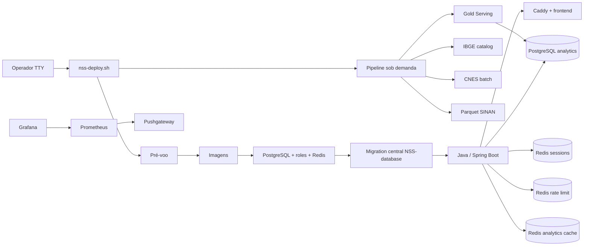
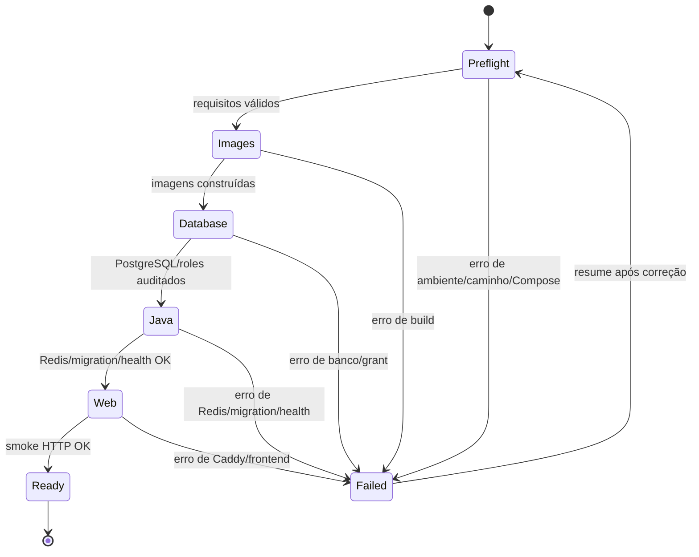

# NSS Deployment

Este repositório é o ponto de entrada operacional da NSS. Ele coordena
PostgreSQL, Redis, Java, frontend, observabilidade e as operações sob demanda
da Pipeline. O código de negócio continua nos repositórios independentes.

## Fonte de verdade operacional

Toda operação de servidor deve ser feita pelo [`scripts/nss-deploy.sh`](scripts/nss-deploy.sh).
O README explica o fluxo; não duplica comandos manuais de Docker, Git,
migration ou Pipeline. O script é responsável por pré-voo, ordem, checkpoints,
barra de progresso, diagnóstico e mensagens de erro.



## Repositórios e referência de código

O script espera estes repositórios lado a lado, salvo quando os caminhos forem
alterados por `NSS_*_REPO`:

```text
NSS-deployment/
NSS-database/
Site-Sala-de-Situa-o-de-Saude-Java/
nss-front-end/
nss-pipeline/
```

O Deployment não troca branches e não executa `git switch` ou `git pull`. Todos
os repositórios devem estar previamente na mesma referência aprovada. Para o
trabalho atual, a referência é `feat/national-coverage-validation`; uma release
pode usar tags ou outro commit imutável, desde que todos os componentes sejam
compatíveis. A escolha da referência é responsabilidade do operador, não do
script.

## Secrets e ambiente

O único modelo de ambiente do deploy integrado é
[`NSS-deployment/.env.example`](.env.example). Os `.env.example` dos demais
repositórios servem somente para execução isolada.

No servidor, o arquivo efetivo fica fora do Git em `/etc/nss/deployment.env`.
Ele deve conter valores reais, ser legível somente pelo usuário de deploy e
conter credenciais distintas por função. O caminho pode ser substituído por
`NSS_ENV_FILE`. Para teste local, use `.env.local.test` com credenciais
descartáveis e aponte o script explicitamente para a cópia local.

O ambiente de produção configura PostgreSQL, JWT, Redis, CORS, imagens, Grafana
e SMTP. Para Gmail, use uma conta Google com autenticação de dois fatores ativa
e uma senha de app; o endereço vai em `MAIL_USERNAME`/`MAIL_FROM` e a senha de
app em `MAIL_PASSWORD`. O perfil local usa Mailpit e não envia e-mail real.

## Máquina de estados



Os estados de infraestrutura são persistidos em `.nss-deploy-state`, ignorado
pelo Git. `resume` retoma etapas concluídas sem reconstruí-las; checkpoints de
CNES e manifestos de Parquet são independentes e ficam no volume `pipeline_data`.
`reset-state` deve ser usado somente quando a infraestrutura ou as imagens forem
deliberadamente recriadas.

Cada etapa mostra uma barra de atividade com tempo decorrido. Downloads e
processamentos cujo total não é conhecido não recebem percentual inventado: a
barra fecha em 100% somente após validação, checkpoint e promoção concluírem.

## Etapas do script

### Pré-voo

O script mostra um menu antes de alterar qualquer estado e valida, nesta ordem:

1. Docker Compose instalado;
2. caminhos dos quatro repositórios;
3. arquivo de ambiente completo, legível e sem placeholders;
4. configuração efetiva do Compose;
5. confirmação do operador para continuar.

Falhas informam o caminho ou variável exata. Nenhum container é iniciado antes
do pré-voo terminar.

### Bootstrap da aplicação

Depois da confirmação, o script constrói as imagens, sobe PostgreSQL, espera
`pg_isready`, provisiona e audita as roles, sobe os três Redis, aplica a
migration central do `NSS-database`, inicia Java, aguarda seu healthcheck, sobe
frontend/Caddy/Prometheus/Grafana e executa o smoke test HTTP.

O Java usa PostgreSQL operacional e analytics, Redis de sessões, Redis de rate
limit e Redis de cache. O frontend acessa somente Caddy; não acessa banco ou
Parquet.

### Pipeline sob demanda

O menu oferece as operações abaixo, executadas no serviço Compose da Pipeline:

| Etapa | Operação | Regra de segurança |
|---:|---|---|
| 1 | Preflight da Pipeline | imagem e contratos válidos |
| 2 | Verificar IBGE ativo | release validada e cobertura nacional |
| 3 | Atualizar IBGE | DTB, SHA-256 e promoção atômica |
| 4 | Verificar CNES | mostra lotes, status, linhas e municípios |
| 5 | Baixar/atualizar CNES | checkpoint; `PARTIAL` não serve Gold |
| 6 | Verificar manifesto Parquet | preserva estado atual |
| 7 | Verificar/baixar Parquet SINAN | atualização incremental por doença/ano |
| 8 | Gold Serving | exige batch CNES `COMPLETED` e confirmação `SIM` |

O atualizador SINAN compara o manifesto e baixa somente fontes necessárias. Em
caso de erro, o manifesto anterior é preservado. A Gold publica no PostgreSQL
somente após validação territorial, CNES e contrato de serving.

## Diagnóstico e recuperação

O script oferece status, diagnóstico, logs recentes, portas, recursos,
resolução interna Java→Redis e smoke HTTP. Após corrigir a causa de uma falha,
use `resume`. O script não executa rollback automático: rollback de release,
restauração de backup e troca de imagem são operações controladas pelo runbook
de produção.

## Limites explícitos

- não instala Docker nem configura o sistema operacional;
- não altera branches nem atualiza repositórios;
- não cria secrets nem pergunta valores reais de credenciais;
- não executa carga nacional sem confirmação;
- não publica PostgreSQL, Java ou observabilidade diretamente na Internet;
- não substitui ensaio de carga e rollback em pré-produção.

## Documentos relacionados

- [`scripts/README.md`](scripts/README.md): referência detalhada do script;
- [`compose.yaml`](compose.yaml): topologia efetiva dos serviços;
- [`contracts/`](contracts/): contratos de autenticação e Gold Serving;
- [`runbooks/`](runbooks/): procedimentos de operação e recuperação;
- [`docs/VALIDACAO_PLANO_LOCAL.md`](docs/VALIDACAO_PLANO_LOCAL.md): evidências,
  testes e limitações da validação local.
