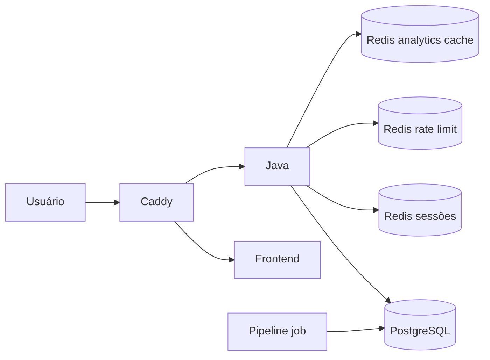

# Núcleo de Situação de Saúde - Deployment e Arquitetura

Este repositório é a **fonte normativa de integração e deployment** do sistema do Núcleo de Situação de Saúde (NSS) da Universidade Estadual do Norte Fluminense Darcy Ribeiro (UENF). Ele registra o escopo aprovado da NSS 1.0, os contratos entre componentes, a arquitetura de execução e os runbooks necessários para colocar a primeira versão integrada em funcionamento.

O NSS **não é um monorepo**. Frontend, backend Java, pipeline Python e configuração NixOS permanecem versionados em repositórios independentes. Este repositório não concentra código de negócio; ele define como os componentes devem convergir para formar um único sistema.

## Release-alvo

A release integrada alvo desta documentação é a **NSS 1.0**, com Frontend V2, prevista inicialmente para homologação em **02/10/2026**.

A NSS 1.0 responde, com dados do SINAN/PySUS, perguntas sobre **notificações** de Dengue, Febre Maculosa e Toxoplasmose, dentro do recorte aprovado. O termo "casos" só poderá substituir "notificações" quando a regra epidemiológica de classificação estiver formalmente validada para cada agravo.

### Escopo funcional congelado

- municípios: cobertura nacional por UF e município; a validação obrigatória de referência inclui os 92 municípios do Estado do Rio de Janeiro;
- perspectiva geográfica da V1.0: **local da notificação**, não residência do paciente;
- detalhamento intramunicipal disponível para os municípios com território resolvido, com validação obrigatória de todos os distritos/bairros dos 92 municípios do Rio de Janeiro;
- hierarquia nacional: região -> UF -> município -> distrito/bairro/localidade da **unidade notificadora**;
- período oficial: ano e mês derivados de `DT_NOTIFIC`;
- sexo: Todos, Masculino e Feminino; valores ignorados continuam preservados nos dados;
- faixa etária: `<1`, `1-4`, `5-9`, `10-14`, `15-19`, `20-39`, `40-59`, `60-64`, `65-69`, `70-74`, `75-79`, `80+`;
- múltiplas faixas etárias simultâneas ficam fora da V1.0;
- bairro de residência fica para versão futura dependente da parceria com o CIEVS;
- CEP e identificadores pessoais diretos não são necessários para esta versão e não devem ser solicitados para esse objetivo;
- o CIDAC é apenas referência conceitual da hierarquia distrito -> bairro/localidade; os GeoJSON continuam sendo produzidos por Python para o frontend;
- localização pública de UBS no mapa é um artefato de visualização client-side e não faz parte do grão analítico da Gold Serving.

## Repositórios

| Componente | Repositório | Responsabilidade |
|---|---|---|
| Frontend | `Zadoque/nss-front-end` | React/TypeScript, login, mapas, filtros, acessibilidade e consumo da API Java |
| Backend Java | `ArtursPereira/Site-Sala-de-Situa-o-de-Saude-Java` | Spring Boot, autenticação, autorização, sessão, API REST e leitura do PostgreSQL |
| Pipeline | `Zadoque/NSS-pipeline` | PySUS/SINAN, CNES, Bronze -> Silver -> Gold, validação e carga do schema `analytics` |
| Deployment | `Zadoque/NSS-deployment` | Contratos, arquitetura integrada, Compose, Caddy, runbooks e documentação normativa |
| Host NixOS | `Zadoque/nss-NixOS-Configuration` | Configuração declarativa do servidor, firewall, SSH, Docker, ngrok temporário e WireGuard definitivo |

O repositório Java poderá permanecer no repositório atual com acesso de colaborador ou ser trabalhado por fork/PR, sem alterar o contrato de integração documentado aqui.

## Arquitetura da NSS 1.0

```text
                         INTERNET
                            |
                    ngrok HTTPS (temporário)
                            |
                            v
                         Caddy
                       /       \
                      v         v
                 Frontend     /api/*
                                |
                                v
                          Java/Spring Boot
                           /            \
                          v              v
                    Redis persistente  PostgreSQL
                    sessões/rate-limit  /        \
                                      v          v
                              tabelas app    analytics.*
                              schema app   schema analytics
                                       ^
                                       |
PySUS/SINAN -> Bronze -> Silver -----+----> Gold Ad Hoc
                                      |
                                      +----> Gold Serving V1
                                       ^          ^
                                       |          |
                         IBGE/reference catalog  CNES
                         identidade, escopo      unidades notificadoras
```

O frontend nunca acessa diretamente o PostgreSQL ou os Parquets. A API Java é o único caminho síncrono oficial da aplicação. O pipeline roda fora do caminho crítico de consulta e publica dados já processados.

O IBGE é uma dependência territorial da pipeline: fornece a identidade
canônica dos municípios, UFs, códigos de sete dígitos, seleção de escopo e a
release territorial usada para validar a publicação. O CNES é uma dependência
de unidades notificadoras: relaciona `ID_UNIDADE` do SINAN ao estabelecimento
e permite derivar o distrito/bairro da notificação. Ambos participam da Gold;
nenhum deles é acessado diretamente pelo frontend ou pelo Java em runtime.

Além do fato analítico, a pipeline mantém `analytics.pipeline_current_publication`, uma tabela de controle com a chave doença/ano/município, `batch_id`, `source_extracted_timestamp` e `added_at`. O Java usa essa tabela por igualdade com o lote publicado; assim, consultas e metadados exibidos no frontend pertencem exatamente à publicação corrente, sem depender de `MAX()`.

## Autenticação da V1.0

- homepage pública;
- dashboard `/mapa` protegido;
- login por e-mail e senha;
- senha armazenada com Argon2;
- access token JWT curto;
- refresh token opaco, rotacionado e armazenado no navegador apenas como cookie `HttpOnly`, `Secure` e `SameSite=Strict`;
- refresh session persistida no Redis com TTL/AOF; rate limit de login e reset executado por scripts atômicos Redis;
- logout revoga o refresh token;
- auto-registro público desabilitado;
- CRUD de usuários não é uma API comum do dashboard na V1.0;
- frontend e Java ficam sob a mesma origem via Caddy, reduzindo a superfície de CORS e cookies cross-site.

O contrato completo está em [`contracts/auth-v1.md`](contracts/auth-v1.md).

## Dados e Gold Serving

A pipeline passa a distinguir formalmente:

```text
Silver
  |-- Gold Ad Hoc       -> exploração, auditoria e debugging
  `-- Gold Serving V1   -> contrato fixo aceito pelo loader/PostgreSQL
```

O menor grão analítico necessário à NSS 1.0 é composto por doença, ano, mês, município da notificação, distrito/bairro da unidade notificadora, sexo e faixa etária. As agregações solicitadas pela interface são executadas no PostgreSQL/Java por `SUM` e `GROUP BY`; o frontend não soma dados epidemiológicos.

O contrato está em [`contracts/serving-v1.md`](contracts/serving-v1.md).

## Observabilidade

A V1.0 incorpora uma auditoria mínima em Grafana, mantendo a capacidade de comparar quatro checkpoints:

1. Bronze - quantidade recebida;
2. Silver - quantidade após limpeza/deduplicação;
3. Gold - soma da métrica publicada;
4. PostgreSQL - soma equivalente após a carga.

O objetivo imediato é provar conservação/reconciliação entre camadas. Dashboards históricos, alertas avançados, DuckDB e observabilidade distribuída ficam para evoluções posteriores.

No Compose integrado, o pipeline envia métricas ao Pushgateway, o Prometheus faz a retenção/consulta e o Grafana consome o Prometheus por datasource provisionado. Grafana, Prometheus e Pushgateway ficam presos ao loopback do host; não são pontos públicos do Caddy.

## Deployment temporário e definitivo

### Bootstrap temporário

```text
Web:  Internet -> ngrok HTTPS -> Caddy -> Front/Java
Admin: Internet -> ngrok TCP -> SSH key-only
```

O ngrok existe apenas enquanto a GINFO não libera a conectividade institucional necessária. PostgreSQL e Java não são publicados diretamente.

### Estado definitivo

```text
Web:   Internet -> domínio institucional -> Caddy -> NSS
Admin: WireGuard -> SSH key-only
```

A configuração do host vive em `nss-NixOS-Configuration`. Este repositório documenta somente o contrato entre o host e a aplicação.

## Artefatos operacionais

- [`compose.yaml`](compose.yaml): stack integrada mínima;
- [`scripts/nss-deploy.sh`](scripts/nss-deploy.sh): menu terminal idempotente com cronômetro, progresso e diagnóstico;
- [`caddy/Caddyfile`](caddy/Caddyfile): entrada HTTP única da aplicação;
- [`.env.example`](.env.example): variáveis esperadas, sem segredos reais;
- [`contracts/`](contracts/): contratos da API, autenticação e Gold Serving;
- [`runbooks/`](runbooks/): bootstrap ngrok, deployment e rollback;
- [`documentacao/`](documentacao/): arquitetura detalhada em LaTeX/PDF;
- [`perguntas/`](perguntas/): registro das perguntas de negócio, decisões já tomadas e itens futuros.

## Subida completa da aplicação

### Menu operacional

Para executar o runbook de forma guiada no terminal do servidor:

```bash
chmod +x scripts/nss-deploy.sh
./scripts/nss-deploy.sh
```

O menu separa verificação, build, PostgreSQL/roles, Redis/schema central/Java,
catálogos, ingestão CNES nacional com checkpoint, pipeline, frontend/Caddy/observabilidade e diagnóstico. Cada etapa
mostra início, fim e duração; a opção de diagnóstico exibe `docker compose ps`,
portas locais, consumo dos containers, resolução interna `java -> redis`,
`PONG` do Redis, status HTTP do Caddy e logs recentes. A execução nacional da
pipeline exige confirmação digitando `SIM` e não trunca tabelas nem remove
volumes automaticamente.

A opção de ingestão CNES solicita o número de workers e o nome do checkpoint.
O arquivo fica no volume `pipeline_data` e pode ser reutilizado após uma
interrupção; o catálogo IBGE e o escopo nacional são validados antes das
requisições. Execute essa opção antes da pipeline SINAN quando a publicação
precisar de cobertura territorial nacional.

Esta seção é o procedimento operacional para subir a NSS do zero no host de
deployment. Execute os comandos a partir de `NSS-deployment`. Os quatro
repositórios devem estar lado a lado:

```text
NSS-deployment/
NSS-pipeline/
NSS-front-end/
Site-Sala-de-Situa-o-de-Saude-Java/
```

### 1. Pré-requisitos

Instale Docker Engine com Docker Compose v2, Git, `curl` e ngrok. Confirme:

```bash
docker version
docker compose version
git --version
curl --version
ngrok version
```

Use a branch `main` dos repositórios e confira as imagens antes de publicar:

```bash
for repo in NSS-deployment NSS-pipeline NSS-front-end Site-Sala-de-Situa-o-de-Saude-Java; do
  git -C "../$repo" switch main
  git -C "../$repo" pull --ff-only
done
```

### 2. Configurar o ambiente e os segredos

```bash
cp .env.example .env
chmod 600 .env
```

Edite `.env` e substitua todos os valores obrigatórios. `JWT_SECRET` deve ser
um segredo aleatório com pelo menos 32 bytes. `POSTGRES_ADMIN_PASSWORD`,
`GRAFANA_ADMIN_PASSWORD` e `BOOTSTRAP_ADMIN_PASSWORD` nunca devem ser
versionados nem colados em comandos gravados no histórico do shell.

O arquivo também separa as credenciais por responsabilidade: `APP_RUNTIME_*`
é usado pelo Java em execução, `APP_MIGRATOR_*` pelo job de schema,
`ANALYTICS_READER_*` pelo Java para consultas, `ANALYTICS_WRITER_*` pela
pipeline e `ANALYTICS_MIGRATOR_*` pelo job de schema. Nenhum serviço deve usar a
credencial administrativa do PostgreSQL.

Para gerar um segredo JWT:

```bash
openssl rand -base64 48
```

O `BOOTSTRAP_ADMIN_EMAIL` e o `BOOTSTRAP_ADMIN_PASSWORD` criam o administrador
inicial do Java. Depois do primeiro login, remova esses valores do `.env` e
recrie o serviço Java para que a credencial de bootstrap não permaneça na
configuração operacional.

### 3. Construir as imagens

O frontend precisa ser construído com `VITE_USE_MOCKS=false` e com API relativa
(`VITE_API_BASE_URL=`), pois o Caddy encaminha `/api/*` para o Java:

```bash
docker build -t nss-java:local ../Site-Sala-de-Situa-o-de-Saude-Java
docker build \
  --build-arg VITE_USE_MOCKS=false \
  --build-arg VITE_API_BASE_URL= \
  -t nss-frontend:local ../NSS-front-end
docker build -t nss-pipeline:local ../NSS-pipeline
```

Antes de subir os serviços, confirme que o Compose está apontando para as
mesmas tags recém-construídas:

```bash
docker compose config --images | sort -u
```

O `.env` não deve declarar a mesma variável duas vezes: o Compose considera a
última ocorrência, o que pode fazer uma imagem antiga como
`nss-pipeline:production-readiness-test` vencer a imagem local atualizada.
Se a saída mostrar outra tag, corrija o `.env` ou execute explicitamente, por
exemplo, `NSS_PIPELINE_IMAGE=nss-pipeline:local docker compose ...`.

Em uma release imutável, prefira tags com o SHA dos commits e configure as
variáveis `NSS_JAVA_IMAGE`, `NSS_FRONTEND_IMAGE` e `NSS_PIPELINE_IMAGE` no
`.env`. Nunca use `latest` para as imagens da aplicação em produção.

### 4. Subir o PostgreSQL e provisionar as roles

```bash
docker compose up -d db
docker compose ps db
docker compose run --rm db-permissions
```

`db-permissions` cria as roles definitivas e aplica os grants mínimos. Em uma
instalação nova, o usuário de inicialização do PostgreSQL é
`POSTGRES_ADMIN_USER`; ele não é usado pelo Java, pela pipeline ou pelo
Grafana. Se o volume já existir com outro usuário administrativo, não altere
o `.env` esperando que o PostgreSQL o substitua: use o procedimento de
recriação do ambiente homologação ou execute o provisionamento com uma
conexão administrativa autorizada.

### 5. Aplicar os schemas

O serviço `migrate` aplica a versão 0001 mantida em `NSS-database` aos bancos operacional e analítico. Construa a imagem central e execute o provisionamento antes da migração:

```bash
docker build -t nss-database:0001 ../NSS-database
docker compose run --rm db-permissions
docker compose run --rm migrate
docker compose up -d java
```

O job valida a versão e o checksum antes de reaplicar. A versão inicial destina-se a bancos novos e rejeita schemas legados sem histórico central. A migração de dados existentes exige procedimento próprio e validação prévia.

O Compose usa `POSTGRES_APP_DB` para as tabelas operacionais e `POSTGRES_DB` para os schemas analíticos. As roles de migração não atendem requisições. O Redis de sessões e o Redis de limites usam volumes persistentes separados. O segundo tem limite de memória configurável por `AUTH_RATE_LIMIT_REDIS_MAXMEMORY` e política `noeviction`. Configure `AUTH_RATE_LIMIT_KEY_SECRET` com segredo próprio e `AUTH_TRUSTED_PROXY_REGEX` apenas para endereços de proxies confiáveis.

### 6. Preparar e verificar o catálogo IBGE

A Gold Serving nacional só pode ser executada com uma release IBGE válida e
ativa. O catálogo fica no volume `pipeline_data`, montado como `/data` dentro
do container da pipeline. Primeiro verifique se já existe uma release ativa:

```bash
docker compose --profile jobs run --rm --entrypoint python pipeline -c \
  'from pathlib import Path; from app.pipeline.reference.ibge.storage import load_active_catalog; c=load_active_catalog(Path("/data/reference/ibge")); print({"catalog_id": c.metadata.catalog_id, "reference_year": c.metadata.reference_year, "validation_status": c.metadata.validation_status, "sha256": c.metadata.sha256, "content_sha256": c.metadata.content_sha256, "municipalities": len(c.municipalities())})'
```

Esse comando falha se `active.json` estiver ausente, se o manifesto não tiver
SHA-256 válido, se `validation_status` não for `VALIDATED`, se os Parquets
auxiliares estiverem ausentes ou se o hash lógico divergir. Não execute o
serving nacional enquanto essa verificação falhar.

Para carregar uma nova release, execute o refresh dentro do serviço da
pipeline. O `--expected-sha256` deve ser o SHA-256 oficial informado pela
fonte IBGE:

```bash
docker compose --profile jobs run --rm --entrypoint python pipeline \
  -m app.pipeline.reference.ibge.refresh \
  --root /data/reference/ibge \
  --catalog-id ibge-dtb-2025 \
  --reference-year 2025 \
  --dtb-url 'https://geoftp.ibge.gov.br/organizacao_do_territorio/estrutura_territorial/divisao_territorial/2025/DTB_2025.zip' \
  --expected-sha256 '<SHA256_OFICIAL_IBGE>'
```

O refresh só promove `active.json` depois de validar a release. Verifique
novamente o catálogo após o carregamento:

```bash
docker compose --profile jobs run --rm --entrypoint python pipeline -c \
  'from pathlib import Path; from app.pipeline.reference.ibge.storage import load_active_catalog; c=load_active_catalog(Path("/data/reference/ibge")); print(c.metadata.catalog_id, c.metadata.validation_status, c.metadata.sha256, len(c.municipalities()))'
```

### 7. Carregar e verificar o CNES

O CNES deve ser carregado depois de o IBGE estar ativo. A execução grava
Bronze, Silver, `metadata.json` e um `batch_id` no mesmo volume persistente:

```bash
docker compose --profile jobs run --rm --entrypoint python pipeline \
  -m app.pipeline.run_cnes \
  --catalog-root /data/reference/ibge \
  --all-brazil \
  --checkpoint /data/reference/cnes-checkpoint.json \
  --workers 8 \
  --continue-on-error
```

Depois da execução, liste os lotes CNES e seus estados:

```bash
docker compose --profile jobs run --rm --entrypoint python pipeline -c \
  'from pathlib import Path; import json; root=Path("/data/silver/cnes"); rows=[]; [rows.append({"batch_id": p.parent.name.removeprefix("batch_id="), "status": json.loads((p.parent/"metadata.json").read_text())["status"], "rows": json.loads((p.parent/"metadata.json").read_text()).get("rows")}) for p in sorted(root.glob("batch_id=*/data.parquet"))]; print(*rows, sep="\n")'
```

Escolha somente um lote cujo `status` seja `COMPLETED`. Lotes `PARTIAL`, sem
`metadata.json`, com manifesto inconsistente ou incompatíveis com a release
IBGE ativa não podem ser usados:

```bash
export CNES_BATCH_ID='YYYYMMDDTHHMMSSZ'
```

Antes da Gold Serving, confirme que o lote escolhido existe e está íntegro:

```bash
docker compose --profile jobs run --rm \
  -e CNES_BATCH_ID="$CNES_BATCH_ID" \
  --entrypoint python pipeline -c \
  'from pathlib import Path; import json, os; batch=os.environ["CNES_BATCH_ID"]; p=Path("/data/silver/cnes")/f"batch_id={batch}"; m=json.loads((p/"metadata.json").read_text()); assert m["batch_id"]==batch and m["status"]=="COMPLETED"; print(m)'
```

Publique o snapshot CNES validado na dimensão analítica do PostgreSQL. O
`--source` fixa exatamente o lote que foi verificado; não use implicitamente
o lote mais recente em uma carga de homologação:

```bash
docker compose --profile jobs run --rm \
  -e CNES_BATCH_ID="$CNES_BATCH_ID" \
  --entrypoint python pipeline \
  -m app.pipeline.load_cnes \
  --catalog-root /data/reference/ibge \
  --source "/data/silver/cnes/batch_id=${CNES_BATCH_ID}/data.parquet"
```

Confirme que a dimensão CNES recebeu registros antes de publicar o SINAN:

```bash
docker compose exec -T db psql \
  -U "$POSTGRES_ADMIN_USER" \
  -d "$POSTGRES_DB" \
  -c 'SELECT count(*) AS unidades_cnes FROM analytics.dim_unidade_saude;'
```

### 8. Carregar o SINAN na Gold Serving

O serviço `pipeline` pertence ao profile `jobs`, portanto é um job sob demanda
e não um servidor web. Ele usa exclusivamente `ANALYTICS_WRITER_*`. Para uma
primeira carga nacional, informe explicitamente o catálogo IBGE e o lote CNES
`COMPLETED`:

```bash
docker compose --profile jobs run --rm pipeline \
  --disease DENG \
  --year 2026 \
  --catalog-root /data/reference/ibge \
  --all-brazil \
  --cnes-batch-id "$CNES_BATCH_ID"
```

Repita para cada doença/ano liberado. A carga só deve ser promovida depois de
validar o manifesto, o catálogo IBGE, o batch CNES e a reconciliação Gold =
PostgreSQL. A Gold Serving rejeita automaticamente a ausência de
`--cnes-batch-id`, lote CNES `PARTIAL`, release IBGE inválida ou escopo
incompatível.
Consulte o README do `NSS-pipeline` para carga nacional, CNES, escopo IBGE e
opções de atualização SINAN.

### 8.1. Reprocessar uma doença nacional usando catálogos já existentes

Quando o IBGE e o CNES nacionais já estiverem carregados no repositório
`NSS-pipeline`, execute o job a partir deste repositório. Não execute o
`docker compose` do repositório da pipeline, pois ele pode subir outro
PostgreSQL (`nss-pipeline-db-1`) e publicar no banco errado.

O procedimento abaixo usa a release IBGE 2025 e o lote CNES nacional 2025 já
existentes em `../NSS-pipeline/data`:

```bash
# 1. A imagem é construída no repositório da pipeline.
docker build -t nss-pipeline:local ../NSS-pipeline

# 2. Verifique a release IBGE ativa no mesmo diretório que será montado no job.
docker run --rm \
  -v "$PWD/../NSS-pipeline/data:/data:ro" \
  nss-pipeline:local python -c \
  'from pathlib import Path; from app.pipeline.reference.ibge.storage import load_active_catalog; c=load_active_catalog(Path("/data/reference/ibge")); print({"catalog_id": c.metadata.catalog_id, "reference_year": c.metadata.reference_year, "validation_status": c.metadata.validation_status, "sha256": c.metadata.sha256, "municipalities": len(c.municipalities())})'

# 3. Confirme o CNES nacional 2025.
docker run --rm \
  -v "$PWD/../NSS-pipeline/data:/data:ro" \
  nss-pipeline:local python -c \
  'import json; from pathlib import Path; p=Path("/data/reference/cnes-2025.json"); m=json.loads(p.read_text()); print({"status": m["status"], "municipios": len(m["municipios"]), "output_path": m["output_path"]}) ; assert m["status"] == "COMPLETED"'

# 4. Se for necessário deixar o banco analítico vazio, preserve migrations
#    e trunque apenas as tabelas de analytics. NÃO use down -v.
docker compose exec -T db sh -lc \
  'PGPASSWORD="$POSTGRES_PASSWORD" psql -v ON_ERROR_STOP=1 -U "$POSTGRES_USER" -d "$POSTGRES_DB" -c "TRUNCATE TABLE analytics.fato_casos, analytics.pipeline_publications, analytics.dim_unidade_saude, analytics.dim_municipio, analytics.dim_doenca, analytics.dim_classificacao, analytics.dim_evolucao CASCADE;"'

# 5. Garanta que o schema esteja atualizado antes da carga.
docker compose run --rm migrate

# 6. Rode a pipeline pelo Compose do deployment, montando os artefatos
#    nacionais da pipeline no /data do container.
NSS_PIPELINE_IMAGE=nss-pipeline:local \
docker compose --profile jobs run --rm \
  -v "$PWD/../NSS-pipeline/data:/data" \
  pipeline \
  --disease DENG \
  --year 2024 \
  --catalog-root /data/reference/ibge \
  --all-brazil \
  --cnes-batch-id 20261103T125935Z
```

Nesse fluxo, `20261103T125935Z` é o `batch_id` nacional concluído do CNES
2025. Se outro lote nacional for selecionado, substitua o valor somente após
validar seu `metadata.json` como `COMPLETED`.

Valide a publicação no banco correto, a partir de `NSS-deployment`:

```bash
docker compose exec -T db sh -lc \
  'PGPASSWORD="$POSTGRES_PASSWORD" psql -U "$POSTGRES_USER" -d "$POSTGRES_DB" -c "SELECT disease_codigo, ano, count(*) AS rows, sum(cases_total) AS cases FROM analytics.fato_casos GROUP BY disease_codigo, ano ORDER BY disease_codigo, ano;"'

docker compose exec -T db sh -lc \
  'PGPASSWORD="$POSTGRES_PASSWORD" psql -U "$POSTGRES_USER" -d "$POSTGRES_DB" -c "SELECT count(*) AS publications FROM analytics.pipeline_publications;"'
```

O resultado deve ser consultado no container `nss-v1-db-1`. Um PostgreSQL
iniciado pelo Compose do repositório `NSS-pipeline` não faz parte desta stack e
não deve ser usado para validar a carga do deployment.

### 9. Subir frontend, Caddy e Grafana

```bash
docker compose up -d frontend caddy grafana
docker compose ps
```

O comando acima também inicia o Redis por dependência do Java. Confirme o
estado persistente antes do smoke test:

```bash
docker compose ps redis java
docker compose exec -T redis redis-cli ping
```

O único ponto HTTP da aplicação é:

```text
http://127.0.0.1:8080
```

O Caddy envia `/api/*` para `java:8080` e o restante para `frontend:80`.
PostgreSQL e Java não possuem `ports` publicados. Grafana fica disponível
somente em `127.0.0.1:3000` e não deve ser exposto pelo ngrok da aplicação.

Valide localmente:

```bash
curl -fsSI http://127.0.0.1:8080/
curl -fsS http://127.0.0.1:3000/api/health
docker compose ps
```

### 10. Configurar CORS e ngrok

O frontend servido pelo Caddy usa a mesma origem e normalmente não exige CORS
para chamar `/api`. Quando a URL HTTPS do ngrok for usada, configure-a também
como origem autorizada no Java:

```bash
./scripts/configure-ngrok.sh https://seu-endereco.ngrok-free.dev
```

O script valida o formato HTTPS, grava `CORS_ALLOWED_ORIGINS`, força
`NSS_HTTP_PORT=8080`, valida o Compose e recria somente `java` e `caddy`. Ele
não abre portas adicionais e não publica Java, banco ou Grafana.

Em outro terminal, mantendo o script do ngrok em execução:

```bash
ngrok http http://127.0.0.1:8080
```

Se o endereço for aleatório, execute novamente o script com o novo endereço e
aguarde a recriação do Java. O endereço compartilhado deve ser o HTTPS do
ngrok, nunca `:8080`, `:3000`, `:5432` ou a porta interna `8080` do Java.

### 11. Smoke test completo

```bash
PUBLIC_URL=https://seu-endereco.ngrok-free.dev
curl -fsSI "$PUBLIC_URL/"
curl -fsSI "$PUBLIC_URL/mapa"
```

No navegador, valide nesta ordem:

```text
Home pública
  -> /mapa redireciona para login
  -> login com o administrador bootstrap
  -> consulta real no mapa
  -> refresh da sessão
  -> logout
  -> /mapa volta a exigir autenticação
```

Para diagnosticar falhas:

```bash
docker compose logs --tail=200 java frontend caddy grafana
docker compose ps
ss -lntup
```

O `ss` deve mostrar apenas Caddy em `127.0.0.1:8080` e Grafana em
`127.0.0.1:3000`; não deve mostrar Java ou PostgreSQL publicados em interfaces
externas.

### 12. Parar e atualizar

Para reiniciar sem remover dados:

```bash
docker compose restart java frontend caddy grafana
```

Para atualizar uma imagem, reconstrua-a, recrie somente o serviço e repita os
smoke tests:

```bash
docker build -t nss-java:local ../Site-Sala-de-Situa-o-de-Saude-Java
docker compose up -d --force-recreate java
```

Não use `docker compose down -v` em operação normal: isso remove volumes
persistentes do PostgreSQL, Grafana e Caddy. O procedimento de rollback está
em [`runbooks/rollback-v1.md`](runbooks/rollback-v1.md).

## Definition of Done - NSS 1.0

A release só pode ser declarada pronta quando, no mínimo:

- login, refresh e logout funcionarem;
- `/mapa` exigir autenticação;
- pipeline real produzir a Gold Serving V1;
- PostgreSQL receber somente artefato Serving compatível;
- Gold e PostgreSQL reconciliarem seus totais;
- Java responder os endpoints analíticos contratados;
- Frontend consumir a API Java real e não realizar somas epidemiológicas;
- filtros de ano, mês, sexo e faixa etária funcionarem;
- Campos permitir drill-down distrito -> bairro/localidade da unidade notificadora;
- ausência de cobertura não for exibida como zero;
- Caddy for o único ponto de entrada HTTP da stack;
- PostgreSQL e Java não forem expostos diretamente à Internet;
- HTTPS temporário via ngrok funcionar;
- SSH remoto usar somente chave pública;
- um fluxo E2E validar login -> consulta -> refresh -> logout.

Os gates completos da release estão em `documentacao/Section-10-NSS-1-0-Escopo-e-Plano-de-Entrega.tex` e em [`runbooks/deploy-v1.md`](runbooks/deploy-v1.md).

## Princípios que continuam válidos

1. Componentes permanecem em repositórios independentes.
2. Java é a fronteira síncrona oficial do frontend.
3. Python prepara/publica dados; não atende consultas do usuário.
4. PostgreSQL é a persistência compartilhada, com schemas mantidos no repositório NSS-database.
5. Parquet continua sendo parte da rastreabilidade da pipeline.
6. Secrets nunca são versionados.
7. Zero, ausência de registro e ausência de cobertura são estados diferentes.
8. Dados restritos futuros do CIEVS deverão seguir minimização e isolamento próprios; esse problema não é antecipado artificialmente na V1.0.

## Arquitetura e operação TTY



`compose.yaml` define a stack; `caddy/` é a fronteira HTTP; `scripts/nss-deploy.sh` automatiza imagens, banco, roles, Redis, Java, frontend e observabilidade. Em servidor somente TTY, use `./scripts/nss-deploy.sh up`. `runbooks/`, `contracts/` e `observability/` documentam rollback, contratos e métricas.
