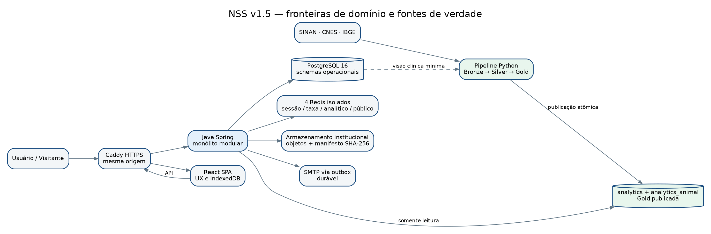
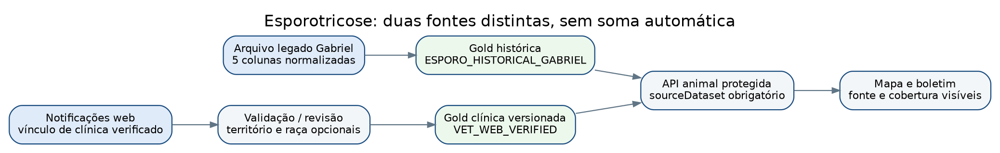
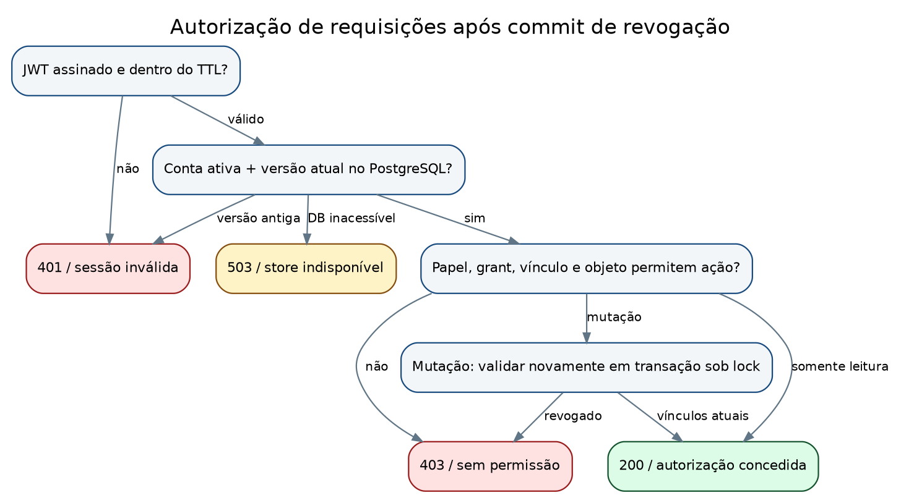

**Sumário executivo de navegação**

- [Controle documental e auditoria de código](#controle-documental-validade-e-escopo)
- [Decisões de arquitetura e invariantes globais](#decisões-de-arquitetura-e-invariantes-globais)
- [Requisitos funcionais P-01 a P-20](#requisitos-funcionais-consolidados-p-01-a-p-20)
- [Especificação técnica T-01 a T-09](#especificação-técnica-t-01-a-t-09)
- [Decisões transversais DT-02 a DT-13](#decisões-transversais-dt-02-a-dt-13)
- [Modelo relacional e índices](#contrato-de-modelos-relacionais-e-índices)
- [Contratos HTTP e exemplos normativos](#contrato-http-e-exemplos-normativos)
- [Estados, concorrência e falhas](#catálogo-de-estados-falhas-e-políticas-operacionais)
- [Sequenciamento de implementação](#plano-de-implementação-por-dependência)
- [22 testes de aceite](#plano-de-testes-de-aceitação-tst-aud-001-a-tst-aud-022)
- [Homologações e gates de publicação](#homologações-institucionais-e-release-gates)
- [Rastreabilidade AUD-001 a AUD-032](#registro-de-rastreabilidade-dos-32-achados)

---

# Controle documental, validade e escopo

**Identificador:** `RFC-NSS-001` · **Versão:** `1.5` · **Corte técnico:** 20/11/2026 · **Status:** especificação técnica consolidada, pronta para planejar e implementar; publicação institucional condicionada às aprovações identificadas na seção de governança. **Substitui, para implementação, as disposições incompatíveis da v1.4.** Não se declara que funcionalidades futuras estão implementadas, nem que a Comunicação, a Epidemiologia Veterinária ou o Encarregado LGPD aprovaram este documento.

**Escopo funcional da V1 ampliada:** portal público de notícias/boletins e páginas institucionais; autenticação; nove papéis com múltiplos vínculos e dois grants de mapa independentes; dashboard humano nacional de notificações; visão veterinária de Campos com proveniência e cobertura explícitas; editor e aprovação de notícias/boletins; solicitações de acesso; clínicas e representantes; notificações veterinárias; recepção manual de arquivos municipais; histórico/auditoria; política de marca, e-mails, acessibilidade, proteção de dados, observabilidade e continuidade. A ingestão automática indiscriminada de planilhas municipais **não** integra a V1. O sistema não certifica dados epidemiológicos como diagnósticos clínicos.

**Convenção normativa:** `DEVE` = obrigatório; `NÃO DEVE` = proibido; `PODE` = opção delimitada. O **contrato de desenvolvimento** desta revisão prevalece sobre exemplos de DDL ou wireframes da v1.4. A aprovação de novas obrigações institucionais pertence às autoridades competentes, não ao autor técnico. Valores de quota, prazos e limites nesta revisão são **defaults de implementação**, alteráveis apenas por configuração versionada, segurança preservada e aprovação do responsável aplicável.

**Fontes verificadas:** RFC v1.4 e Manual de Marca v1.0 anexados à conversa; auditoria HTML do Gemini (32 achados); leitura remota de árvores e arquivos representativos das seguintes branches, com commits fixados:

| Repositório | Branch / commit inspecionado | Papel no sistema |
|---|---|---|
| `Zadoque/NSS-pipeline` | `feat/national-coverage-validation` / `767c46e6ceb1` | SINAN, IBGE, CNES e publicação humana |
| `Zadoque/NSS-pipeline` | `main` / `daf0918b000c`; `feature/pipeline` / `d22171eee7a9` | Oráculo Gold e Load de ESPORO |
| `Zadoque/NSS-pipeline` | `work/nss-pipeline` / `257cc1d1b3aa` | Referência Alembic e publicação corrente |
| `Zadoque/NSS-front-end` | `feat/national-coverage-validation` / `93c889a1d2bf`; `feat/preview-portal-mock-2026` / `17b6689443dd` | Portal atual, autenticação, cache, ativo ilustrado |
| `Zadoque/Site-Sala-de-Situa-o-de-Saude-Java` | `feat/national-coverage-validation` / `815fdf2e66e5` | API e autenticação existentes |
| `Zadoque/NSS-deployment` | `feat/national-coverage-validation` / `8a7f99deb877` | Compose, Caddy e contratos existentes |
| `Zadoque/NSS-database` | `feat/national-coverage-validation` / `00300620f34a` | Esquema humano, legado animal e usuários |

**Limite da verificação:** houve inspeção remota de repositórios, branches, árvores, migrations, contratos e amostras de código; **não** houve checkout local, execução de testes, acesso ao PostgreSQL de produção nem homologação clínica. Por isso, a situação de cada achado é classificada como evidência confirmada, parcial ou divergente, e não como certificação exaustiva de produção. Os links de origem e o registro AUD-001 a AUD-032 aparecem ao final.

## Diagnóstico corrigido da auditoria

A auditoria documental do Gemini é útil, mas não corresponde a uma auditoria executável. Há lacunas reais de novos módulos, mas pelo menos três generalizações precisam ser corrigidas:

1. **Revogação de sessão:** `JwtAuthenticationFilter` já consulta `UserDetails`, verifica `isEnabled` e compara a claim `accountRevision` com a versão da conta. O novo requisito **não** é criar do zero revogação imediata de contas, mas garantir aumento de versão também em toda mutação de `user_roles`, `user_grants`, vínculos e delegações, aplicando os direitos por recurso e transação. O Redis de sessão já é utilizado para geração de refresh; não será fonte única da autorização.
2. **Rate limit:** `AuthRateLimiter` já utiliza scripts Lua e HMAC e, diante de indisponibilidade do Redis, lança `AuthStoreUnavailableException`, ou seja, existe proteção **fail-closed** nas rotas de autenticação atuais. A V1 acrescentará regra para novas rotas, tentativas frustradas versus chamadas totais e concorrência das verificações de senha. Não declarar a proteção como inexistente.
3. **Data humana:** a Silver da pipeline nacional já usa `DT_NOTIFIC` para filtrar por ano e há fallback ISO por `DT_NOTIFIC` no tratamento de semana. A competência humana permanece `DT_NOTIFIC`, sem troca por `DT_SIN_PRI`. A dúvida de data nula pertence especialmente ao fluxo animal.

O `AccountType` do Java contém `ADMIN/USER`; há somente três Redis no Compose nacional; a Gold animal da `main` utiliza **cinco** colunas (`data_notificacao`, `especie_codigo`, `sexo_codigo`, `idade_faixa_codigo`, `castrado_codigo`); a `NSS-database` ainda define a tabela animal legada com textos. Essas faltas exigem implementação e migração; não podem ser classificadas como já concluídas.

# Decisões de arquitetura e invariantes globais

## AD-01 — Arquitetura e bancos

A V1 usa **monólito modular Java 21/Spring Boot** com módulos de domínio e uma pipeline Python independente. Haverá **um PostgreSQL 16 lógico** por ambiente, com isolamento por schemas e roles SQL: `public` (legado de usuários até migração), `identity`, `cms`, `bulletins`, `veterinary`, `municipal`, `messaging`, `institutional`, `audit`, `analytics`, `analytics_animal`, `operational`. Isso é uma **decisão técnica adotada neste RFC**; migração de dois bancos físicos, quando houver, exige ensaio e plano de corte. O Java lê `analytics*` via role de leitura; a pipeline escreve apenas nos analytics e lê uma visão veterinária sanitizada pelo role específico. O React nunca acessa PostgreSQL diretamente.

A cadeia `NSS-database` permanece **autoridade única para DDL de produção**. Migrações Alembic históricas da pipeline são referência de origem, não uma segunda cadeia concorrente de migração no deployment. Nunca recriar `analytics_animal.fato_esporo` sem verificar que está vazia ou sem migração preservadora comprovada. A migration de adaptação aborta se houver registros e não houver plano explícito de backfill. Prefixar novas migrations `0003` em diante com preflight, `information_schema`, idempotência controlada e rollback por release.

{width=95%}

## AD-02 — Fonte da verdade, publicação e fronteiras

As tabelas operacionais são fontes de eventos de negócio e de conteúdo editorial; a Gold é fonte da leitura epidemiológica. **Não se consulta diretamente `veterinary.notifications` para compor um mapa público/protegido.** O Python consome uma visão normalizada somente de notificações elegíveis, executa reconciliação e grava Gold clínica sob nova tabela, sem sobrescrever o contrato de Gabriel. Cada indicador deverá portar `sourceDataset`, `publicationFingerprint`, `publishedAt`, `geographicBasis`, `coverage` e `definitionVersion`.

**Não se somam** automaticamente os totais da Gold histórica de Gabriel e as notificações recebidas pelo portal: sem identificador de reconciliação confiável, pode haver duplicação. As duas fontes devem ser mostradas separadamente até que uma chave de de-duplicação interfonte seja homologada. O mapa por bairro de Campos apresenta **somente registros com território animal documentado e validado**, e bucket de `UNKNOWN_TERRITORY`; ausência de bairro jamais é preenchida com bairro da clínica. Tabelas por raça/SRD do boletim de cães usam exclusivamente a fonte com raça registrada, com denominador e percentuais de completude explícitos. Na falta de dados elegíveis, apresentar `UNAVAILABLE` em vez de zero. Assim a funcionalidade V1 é implementável sem adulterar a Gold existente nem afirmar cobertura total.

{width=88%}

## AD-03 — Consistência e segurança

Todas as operações de efeito externo usam **transação, idempotência, histórico e auditoria**. Nenhuma confirmação de e-mail, simples recebimento SMTP ou visualização de botão do React atribui direitos. Nunca usar autorização guardada exclusivamente em JWT, Redux, Redis ou IndexedDB. `401` significa ausência/sessão inválida; `403` significa sessão válida sem permissão; `409` significa conflito de estado/versão; `422` significa regra de negócio semanticamente inválida; `503` é indisponibilidade transitória dependente de serviço. A classe `500` não divulga detalhes internos.

A V1 utiliza um único namespace de API `/api/v1`, preservando as rotas humanas já publicadas e o alias operacional `/api/public` para conteúdos públicos; o OpenAPI versionado precisa representar ambos. Identificadores de recursos são UUID v4 ou IDs existentes com migração não destrutiva. Todos os timestamps são `timestamptz` UTC no banco e apresentados com fuso de `America/Sao_Paulo` quando apropriado. Competência é identificada por `YYYY-MM` e não é confundida com data de extração ou publicação.

{width=82%}

# Requisitos funcionais consolidados P-01 a P-20

## P-01 — Portal público e mapas protegidos

Visitantes podem ler homepage, `/sobre`, notícias e boletins **publicados**, buscar publicações, iniciar login/recuperação e solicitar acesso. Dashboard humano, dashboard animal, exportações epidemiológicas, dados cartográficos enriquecidos por contagens e suas APIs são **protegidos**. GeoJSON puramente geográfico e sem métricas pode ser público, com créditos de origem. `prod-mock` e snapshots de desenvolvimento não podem ser expostos na build institucional. A autorização HTTP é sempre feita no Java, mesmo ao acessar URL diretamente.

## P-02 — Solicitação pública de acesso

O formulário tem **duas etapas**: preenchimento de nome, e-mail e justificativa e depois revisão explícita, consentimentos/ciência pertinentes e envio irrevogável por `Idempotency-Key`. Resposta genérica `202` para endereço novo ou existente, sem enumeração. Link de confirmação do e-mail em até **24h**; só após confirmação o pedido `PENDING_REVIEW` entra na fila de aprovação. Contas existentes não são duplicadas; uma conta ativa pode solicitar outro papel e um pedido para conta suspensa requer decisão humana, sem reativação automática. Reenvio de link cria token novo e invalida o anterior, sob quota.

O protocolo de acompanhamento usa segredo separado, validade **30 dias após a decisão final**, permite consulta do próprio status e nunca exibe usuários de terceiros. Recusa comunica o resultado e impõe intervalo de **72h** antes de novo pedido; solicitações não verificadas expiram em **24h** e não consomem quota de 3 pedidos confirmados/30 dias, embora continuem sujeitas à quota por IP. Dois aprovadores concorrentes: apenas o primeiro commit altera o pedido e cria/concede identidade, o segundo recebe `409 REQUEST_ALREADY_DECIDED`. Destinatários configurados precisam estar ativos; se nenhum, a notificação é direcionada a todos os Chefes Gerais ativos e o sistema gera alerta.

## P-03 — Nove papéis, multi-role e grants

Papéis: **CHEFE_GERAL, ADMINISTRADOR, AGENTE_EPIDEMIOLOGICO, ANALISTA_DADOS, ESCRITOR_CHEFE, ESCRITOR, REPRESENTANTE_CLINICA, REPRESENTANTE_MUNICIPAL, USUARIO_COMUM**. São nove papéis funcionais, **não** oito. `map.human.view` e `map.animal.view` são **permissões**, não papéis adicionais. Chefe Geral, Administrador, Agente Epidemiológico, Analista de Dados e Escritor-Chefe têm os dois mapas automaticamente. Escritor, Representante de Clínica e Usuário Comum só por grants individuais, independentes; o papel Representante Municipal isolado não concede mapa.

Somente Chefe Geral concede/revoga CHEFE_GERAL/ADMINISTRADOR; Administrador gerencia os demais papéis apenas de contas sem papel administrativo, respeitando escopo. A conta não pode ficar sem pelo menos um Chefe Geral ativo; alterações que possam remover o último obtêm lock da linha `identity.roles(code='CHEFE_GERAL') FOR UPDATE`, verificam cardinalidade sob a mesma transação e abortam `409 LAST_CHIEF_PROTECTED` se restaria zero. O acesso emergencial institucional (**break-glass**) exige solicitação formal da chefia, duas aprovações humanas quando possível, executor TI autorizado e evento de auditoria inviolável. O runbook é entregue com o sistema, nunca uma senha master no código.

## P-04 — Rastreabilidade e créditos editoriais

Publicações preservam ator, papel efetivo no momento, diff/checksum, data/hora, conteúdo da revisão e origem. Crédito público é uma opção por versão: NSS/UENF; autor; autor+revisor; autor+revisor+aprovador, somente com participação efetiva e autorização de exposição do nome. Revogar acesso não destrói o histórico; requerimento LGPD pode resultar em restrição, pseudonimização ou eliminação conforme parecer, sem confundir tombstone com anonimização irreversível.

## P-05 — Notícias e boletins

Escritor cria/edita apenas rascunhos próprios; Escritor-Chefe cria, edita, revisa, rejeita, solicita mudanças, publica e retira notícias de circulação, podendo exercer sozinho essas funções. Para cada notícia há **uma revisão editável ativa**; concorrência controlada por `version`/`If-Match`. As versões anteriores publicadas são imutáveis.

Boletins são gerados de publicações Gold elegíveis e por calendário/solicitação manual sem gerar uma minuta para cada um dos mais de 5,5 mil municípios. Escopos automáticos ficam em `bulletins.auto_scopes`, desabilitados por padrão para novos recortes; configuração inicial recomendada: Brasil e Estado do RJ para visão humana; Campos dos Goytacazes para visão animal, conforme doenças efetivamente publicadas. Calendário mensal não gera boletim sem fonte publicada, não presume publicação editorial automática. Aprovação única e auditada por Chefe Geral ou Agente individualmente delegado. Mudança da fonte gera revisão; revisão pendente anterior vira `SUPERSEDED` sob lock. Despublicação não ressuscita versão histórica automaticamente.

## P-06 — Edição, revisão, correção e SEO

Ao corrigir uma notícia publicada cria-se nova revisão sem alterar bytes da revisão pública. Só a versão aprovada e publicada aparece. `slug` é único e **permanece reservado** mesmo após retirada. A URL pública de conteúdo ausente/não publicado responde `404`; redirecionamento de slug só via registro explícito. Criação e alteração de mídia registram fonte, licença, legenda, texto alternativo e propósito; URLs de mídia de revisão despublicada são bloqueadas quando não há outra referência pública válida.

## P-07 — Gestão de clínicas

Agente Epidemiológico ativo cadastra clínica com nome, CNPJ quando aplicável, CEP/endereço, município IBGE, situação, fonte dos dados e consentimento/legitimidade da publicação pertinente. A gestão é **N:M** em `veterinary.clinic_agents`. O criador torna-se gestor inicial; Chefe Geral pode designar outros gestores, recuperar clínica sem agente ativo e inativar clínica com justificativa, preservando histórico. Clínica inativa não recebe novos envios e suspende convites/novas submissões; notificações históricas e eventos de retificação continuam auditáveis.

## P-08 — Convites e representantes

Convite vinculado a **uma clínica específica** com e-mail normalizado, token hash de uso único, expiração **72h** e identidade existente reaproveitada. Somente gestores ativos da clínica e Chefe Geral podem convidar/revogar membros. O vínculo usa `id` substituto e índice parcial `UNIQUE(user_id,clinic_id) WHERE status='ACTIVE'` para permitir revogação e convite futuro sem apagar histórico. Aceite valida novamente conta, clínica, convite e escopo sob lock; convite expirado ou clínica inativa não cria vínculo. Agente só pode conceder/revogar `map.animal.view` a representante com vínculo ativo em suas clínicas; qualquer permissão mais ampla continua reservada à chefia/administração.

## P-09 — Multi-clínica e notificação

Uma conta pode representar múltiplas clínicas; ao abrir a notificação, escolhe explicitamente a clínica. `clinic_id` do body não é confiável: validar vínculo ativo no backend no início e na confirmação/commit da operação. A troca de clínica durante rascunho exige decisão de descarte ou cópia de campos permitidos; não transportar dados clínicos automaticamente entre clínicas. Agente Epidemiológico **não** recebe autorização para registrar como representante apenas por ser gestor: pode auxiliar e revisar, mas submete uma notificação clínica somente se possuir vínculo `REPRESENTANTE_CLINICA` ativo naquela clínica, regra que resolve a contradição dos stakeholders.

## P-10 — Recebimento de planilhas municipais

Representante Municipal pode pertencer a **N municípios** por vínculos administrados por Chefe Geral/Admin. O envio exige município vinculado, doença, competência/período, arquivo e declaração de origem; o representante vê apenas seus envios e municípios. O Analista vê fila completa, laudos, quarentena e download autorizado com auditoria. Arquivo corrigido gera novo registro com `supersedes_upload_id`, sem sobrescrever o original; hash igual dentro do mesmo município retorna `409 DUPLICATE_UPLOAD` com ID do registro existente visível ao próprio remetente.

## P-11 — Validação e cotas de arquivos

Aceitar **CSV, XLS, XLSX**; limite padrão **100 MiB** por arquivo, com configuração global versionada pelo Analista. O limite efetivo é fixado na admissão (`effective_limit_bytes`), preservado para upload em andamento, sem permitir contornar o teto máximo da borda. Transmissão via multipart streaming com timeout de **300s**; suporte a retomada em chunks fica fora da V1, devendo a UX informar repetição segura por mesma chave. Sempre validar tamanho por bytes reais, MIME por assinatura, extensão, encoding, estrutura, arquivo Excel como ZIP (máximo descompactado **500 MiB**, proporção máxima **10:1**, limite de entradas, profundidade e células), rejeitar macros e links externos, neutralizar fórmulas em exportações, verificar malware em serviço de inspeção quando disponível e não executar conteúdo. Erros de conteúdo malformado podem virar `QUARANTINED`; ameaça ativa é rejeitada/isolada e nunca oferecida no download comum. Temperários interrompidos são removidos por job com idade limite de 24h.

## P-12 — Retenção, reprocessamento e titularidade

Originais são imutáveis e armazenados fora do webroot, com checksum SHA-256 e trilha de aquisição. O Analista não edita diretamente o original; deriva uma cópia analisável. Retenção **não é indefinida por padrão sem base legal e tabela formal**: a política de temporalidade institucional deve definir classe, base legal, prazo, bloqueio, eliminação e guarda sob litígio. Antes da homologação da temporalidade, o sistema aplica quarentena institucional, restringe acessos e registra revisões; não executa limpeza irreversível arbitrária. Planilha municipal **não** entra automaticamente na Gold humana ou animal.

## P-13 — Catálogo de disponibilidade

Conservar `analytics.pipeline_metadata_current` e `analytics.pipeline_metadata_history` materializados na publicação Gold humana. `AVAILABLE/UNAVAILABLE/PARTIAL` diferenciam cobertura, ausência, nulidade e zero real. `municipality_only`, municípios sem distrito/bairro válido, territórios nominais `CNES_BAIRRO:*` e unidades sem correspondência são preservados em metadados com origem. Não gerar metadados de disponibilidade por scan da tabela fato em toda requisição.

## P-14 — Publicação Gold e invalidação

A pipeline publica fatos, dimensão, metadados e ponteiro de lote **atomicamente**; cache de consulta precisa incorporar um `publicationFingerprint` derivado do ponteiro de snapshot corrente da consulta (não apenas revisão de aplicação). Java consulta a versão vigente autoritativa **antes de ler o Redis**; assim, novas publicações ficam visíveis sem depender do polling editorial. O frontend inclui fingerprint nas chaves do IndexedDB e descarta o anterior em mudança do endpoint `/metadata`, além das invalidações já existentes por usuário, logout e dia operacional. Boletins são gerados por polling idempotente do histórico de publicações, descrito em T-03. Ajuste territorial só altera o fingerprint do boletim se mudar indicadores publicados ou seus metadados de cobertura explicitados.

## P-15 — APIs epidemiológicas independentes

API humana: `/api/v1/epidemiology/*`, leitura nacional, **município/unidade de notificação**. API animal: `/api/v1/animal/epidemiology/*`, leitura dos dados veterinários elegíveis em Campos. `map.human.view` e `map.animal.view` são independentes, inclusive no mesmo JWT. Nunca afirmar que o acesso ao mapa é único. A resposta animal distingue as séries de `ESPORO_HISTORICAL_GABRIEL` e `VET_WEB_VERIFIED` e recusa agregado unificado quando não houver reconciliação verificada.

## P-16 — Idade, espécie, raça e temporalidade

O contrato preservado de Gabriel tem códigos: espécie `0 NI,1 felino,2 canino`; sexo `F,M,i`; castração `0 NI,1 não,2 sim`; idade `0 NI,1 <1,2 1–3,3 4–6,4 7–10,5 >10`. O dado histórico já em categoria **não é recodificado a partir de suposta idade numérica**. No formulário novo, idade não negativa em anos decimais ou meses é convertida por **anos completos = floor(meses/12)** (ou floor de anos decimais), sem arredondar para cima; 0–11 meses→1, 12–47 meses→2, 48–83→3, 84–131→4, ≥132→5. Idade ausente→0. Valor inválido não vira 0 silenciosamente: requer correção ou motivo `NOT_INFORMED`.

Boletim veterinário apresenta resumo por espécie e quadros caninos por raça/SRD **apenas quando há raça colhida e validada**, com `N informado/N elegível/NI`, sexo, castração e faixas. Felinos e espécie não informada aparecem em resumos separados. Registros `data_notificacao IS NULL` ficam em grupo de qualidade **sem competência mensal**: não são atribuídos ao mês de ingestão nem omitidos do inventário total. No SINAN humano, ano/mês derivam de `DT_NOTIFIC`; `DT_SIN_PRI` não substitui silenciosamente a competência. CNES sem território permanece no total do município e em linha "unidade/território não mapeado"; a soma dos bairros georreferenciados pode ser menor que o total municipal.

## P-17 — Autenticação e revalidação de permissões

Manter Argon2, e-mail/senha, access JWT **15 minutos**, refresh opaco rotativo em cookie `HttpOnly,Secure,SameSite=Strict`, normalmente **7 dias**, mesmo domínio Caddy. O filtro atual já valida `accountRevision` e a conta no banco. Extender o controle para `authorization_version` (ou unificar em `account_version` com incremento **obrigatório**) em qualquer alteração de conta, papel, grant, delegação ou vínculo que modifique autorização. Toda rota protegida compara a claim com o **estado atual autoritativo** (PostgreSQL) antes de autorizar; Redis pode acelerar sessão, não permitir token antigo caso a chave esteja defasada. Conflito de versão retorna 401 para token obsoleto; após refresh, permissão perdida retorna 403. Se a consulta autoritativa não puder ser feita, rota protegida falha com 503, não permite acesso por claim antiga.

Senhas novas têm pelo menos **12 caracteres**, limite máximo razoável ≥64, aceitam espaços e Unicode, são comparadas com lista de senhas comprometidas quando viável, sem rotação periódica automática. Reautenticação `step-up` mediante senha atual ou reautenticação recente de **5 min** é obrigatória para promover/rebaixar Chefes Gerais e Administradores, alterar credenciais críticas e acionar break-glass. O limite `10 falhas / 15 min / conta` se refere às falhas, ao lado de limites por IP/global em todas as tentativas. Reservas de tentativa feitas atomicamente por Lua impedem que rajadas concorrentes excedam 10 verificações efetivas; sucesso zera o contador de falhas sem zerar os limites anti-DoS de IP/global.

TTLs de fluxo: confirmação de e-mail **24h**; pedido/protocolo **30 dias após decisão**; convite de clínica **72h**; primeiro acesso aprovado **72h**; reset de senha **1h**; step-up **5 min**; token de sessão **15 min**; refresh **7 dias**. Tokens são aleatórios criptográficos, uso único, persistidos como hash com `purpose` e expiração; nunca armazenados em logs ou enviados por query de analytics.

## P-18 — Armazenamento, backup e continuidade

PostgreSQL em volume persistente, mídia em HD institucional segregado com caminho imutável + digest e nomes opacos, fora do webroot, permissões mínimas e cifra de backup. **Objetivos propostos para homologação TI:** RPO ≤24h e RTO ≤8h para incidente de perda total, com backup diário consistente, backup do manifesto de arquivos e cópia externa institucional **efetivamente testada**; não declarar cumprimento antes de teste. Backup não é apenas `pg_dump`: captura relação `asset_id → sha256 → object_key` e manifesto da mesma geração, arquivos write-once sincronizados e validação no restore. Alertas em 75%/85% e bloqueio de novos uploads em 95% de ocupação. Migrations destrutivas: preferir expand/migrate/contract e ensaio de rollback; `0003` animal deve abortar se houver dados legados não migrados.

## P-19 — Despublicação e URLs

Toda retirada exige justificativa, ator, versão e horário em transação; não apaga histórico. Notícias e boletins retirados deixam listagem/detalhe públicos e retornam `404`, mantendo slug reservado e impedindo restauração automática. Imagens e PDFs são servidos por rota controlada que verifica **referência atualmente publicada** a cada solicitação; `Cache-Control: no-store` em conteúdo sujeito a retirada. Mídia exclusiva fica inacessível; mídia compartilhada com outra publicação válida permanece acessível. O sistema não pode desfazer cópias já baixadas por terceiros.

## P-20 — Continuidade de direitos e delegações

Chefe Geral administra papéis altos e toda configuração institucional; Administrador atua somente dentro de limites; Agentes gerem clínicas e map animal dos seus representantes; Escritor-Chefe controla notícias; Analista controla ingestão manual. A Chefia pode acumular temporariamente papéis funcionais **mediante atribuição explícita, step-up e auditoria** para contingência, jamais pela concessão implícita do papel de chefia. Módulo `audit` preserva ação negada e concedida, origem e requestId. Permissões são verificadas no backend em cada requisição e, em decisões irreversíveis, **novamente dentro da transação**.

# Especificação técnica T-01 a T-09

## T-01 — Dados, schemas, governança de migrations e concorrência

O esquema físico de referência está no artefato `migrations/0003_0006_domains.sql`. A v1.5 introduz, em ordem, `identity` (papéis, grants e solicitações), `operational`/`messaging` (idempotência, cache namespace e outbox), `cms`/`bulletins`/`institutional` (revisões e conteúdo), `veterinary`/`municipal` (dados privados e arquivos), `audit` (eventos). Não substituir `public.users` por `identity.users` sem migração compatível dos IDs, senhas, first-access e sessões. `identity.users` na migração é **visão/compatibilidade ou evolução de `public.users`**, segundo inventário de FKs efetivo: o script SQL suplementar utiliza `public.users(id)` para minimizar risco. Toda criação de índices grandes usar estratégia adequada ao ambiente (DDL `CONCURRENTLY` fora de transação quando necessário).

**Roles SQL:** `nss_app_runtime` pode ler/escrever apenas schemas operacionais necessários, sem DDL e sem escrita nos analytics; `nss_analytics_reader` lê `analytics` e `analytics_animal`, sem `UPDATE`; `nss_analytics_writer` só escreve analytics; `nss_vet_extract_reader` só consulta `veterinary.v_ingestion_eligible` (dados minimizados), sem acesso a informações de tutor não necessárias; `nss_migrator` faz DDL em janela controlada; `nss_audit_reader` restrito. Senhas/roles em secrets, não em Git.

**Invariantes transacionais:** `user_roles` e `user_grants` com unicidade parcial de vínculos vigentes; mudanças de acesso incrementam `public.users.account_version` dentro da mesma transação; dupla atualização usa `WHERE version=?` e `409`; decisões de Chefe Geral serializadas por lock na linha `identity.roles`. Duas transações não devem completar retirando todos os Chefes Gerais. Novas tabelas com `created_at`, `updated_at`, `version`, motivo e ator quando apropriado. Usar `ON DELETE RESTRICT` em evidências históricas e IDs substitutos.

## T-02 — CMS de notícias e mídia

**Estados de revisão:** `DRAFT → IN_REVIEW → (CHANGES_REQUESTED | REJECTED | PUBLISHED)`; `CHANGES_REQUESTED → DRAFT` pelo autor; `REJECTED` é terminal **para aquela revisão**; `PUBLISHED` pode ser retirado (`UNPUBLISHED`) ou substituído por nova versão publicada (`SUPERSEDED`). `APPROVED` não é estado persistido separado na V1: a decisão de aprovação + publicação é **atômica**. `REJECTED` não significa apagar a pauta nem proibir novo post independente. Um único `current_draft_revision_id` por notícia; tentativas de duas revisões em aberto para mesmo post retornam 409. Writer edita somente revisão própria; chief pode revisar e editar qualquer uma. Para conteúdo público, `cms.posts.current_published_revision_id` é o único ponteiro visível.

Conteúdo JSONB Tiptap/ProseMirror validado contra `schemaVersion=1`, allowlist de nós/marcas, URLs HTTPS autorizadas, sanitização de HTML, proibição de script/iframe arbitrário. Na V1 rejeitar `schemaVersion != 1` com 422; migração futura será explícita. Imagens limitadas a **10 MiB** (JPEG/PNG/WebP conferidos por decodificação), avatar **5 MiB**, PDF de boletim **20 MiB**; não confiar em MIME enviado; SVG não renderizável arbitrariamente. Mídias têm `asset_id`, hash, size, width/height, alt, legenda, crédito/licença, tipo, referências. Uma mídia com referência pública remanescente continua pública, e a exclusão física de órfãos requer nenhuma referência ativa, nenhum hold jurídico e idade de pelo menos **30 dias**.

Paginação pública **20 itens/página**, `page=0`, `size` máximo 20, `totalElements`, `totalPages`, `hasNext`, ordenação estável `publishedAt DESC,id DESC`. Busca por PostgreSQL FTS `portuguese`, normalização de acentos, filtros com limites de data; sem SQL dinâmico a partir do usuário. Conflito de edição por `If-Match: "version"` retorna `409 VERSION_CONFLICT` com versão atual (sem vazar conteúdo alheio).

## T-03 — Boletins, eventos de publicação e calendário

A pipeline humana já mantém `analytics.pipeline_publications`, `analytics.pipeline_execution_metrics` e `analytics.pipeline_current_publication` para snapshots. **Não inventar `publication_id` serial que ainda não existe.** Worker Java lê via `analytics_reader` o histórico com identidade composta (`disease_codigo, ano, batch_id, geographic_scope_sha256`, com distinção de escopos), observa novo lote elegível e registra seu progresso **somente** em `bulletins.publication_checkpoints`, sem `UPDATE analytics`. Polling de **60 segundos** e reconciliação integral ao reiniciar; checkpoint é transacional com criação de boletim e fila de comunicação. A aplicação usa `SELECT ... FOR UPDATE SKIP LOCKED` nas próprias filas, deduplicação por `source_fingerprint`, `scope_id`, `competence` e `template_version`, impedindo duplicação sob workers paralelos.

`auto_scopes` registra doença, território (Brasil, UF, município), modelo, periodicidade e enabled. O cron mensal somente enfileira novos candidatos quando existe dado Gold para a competência, e não cria 5.571 boletins por acidente. O fingerprint inclui **valores e metadados materialmente exibidos** (fonte, lote, recorte, data, totais, cobertura e estratos). Comparar fonte nova à versão gerada mais recente; se igual, não gerar nova. Uma revisão `PENDING_REVIEW` anterior vira `SUPERSEDED`; a última versão efetivamente pública continua visível até nova aprovação. O aprovador tem direito vigente e individual (`bulletin.approve` delegado) revalidado sob lock; versões superadas rejeitam com `409 VERSION_SUPERSEDED`. Despublicar `v2` zera o ponteiro público, sem ressuscitar `v1`. Republicar uma anterior exige nova decisão explícita e fingerprint auditado.

Notificações veterinárias elegíveis entram no processo mediante visão privada sanitizada para a pipeline; a Gold histórica é preservada, a nova Gold clínica tem proveniência independente. Competência animal por `data_notificacao` validada, sem classificar nulos no mês. O boletim pode usar quadros vet por raça somente se `sourceDataset='VET_WEB_VERIFIED'` e publicando o denominador real; **nunca** atribuir raça/bairro a linhas históricas sem esses campos. PDFs e HTML de boletim incluem fonte, data de extração, cobertura, diferenças e aviso de notificações ≠ casos confirmados.

## T-04 — Clínicas, ficha veterinária e retificações

Formulário **seis etapas** (não quatro): **1 Clínica e notificador; 2 Animal; 3 Agravo e diagnóstico; 4 Território de residência/exposição; 5 Evolução/anexos; 6 Revisão/confirmação**. Campos adicionais clínicos indicados na v1.4 são propostas **sujeitas à ficha homologada**; a implementação usa dicionário versionado com campos obrigatórios mínimos de proveniência, clínica, espécie, sexo, castração, idade categorizável, data ou motivo de ausência, e consentimentos/base legal aplicáveis; não impor diagnóstico ou tutor obrigatório sem homologação. Número da notificação e `source_event_id` são gerados no servidor.

Estados `DRAFT` (local ou servidor), `SUBMITTED`, `UNDER_REVIEW`, `VALIDATED`, `REJECTED`, `CANCELLED`, `SUPERSEDED`. Após envio, representante não altera linha original: **retificação** cria evento com `revision_of_id` e versionamento; **cancelamento** cria evento de cancelamento com motivo, actor, data. Apenas versões vigentes e validadas entram na visão de ingestão; pipeline que já publicou versão antiga produz nova publicação com correção (não faz DELETE silencioso de Gold auditada). Submissão requer `Idempotency-Key`, vínculo ativo e clínica ativa verificados sob lock. Para dados sensíveis de tutor, coletar o mínimo necessário conforme ficha e base legal confirmadas; **não** transmitir dados pessoais à Gold agregada.

**Integração com Gabriel:** preservar literalmente colunas/códigos de `esporo/gold.py` e `esporo/load.py` da branch `main`; copiar com testes e migration segura. A nova função web para raça/bairro é uma **camada adicional versionada**, não alteração destrutiva da tabela original, até aprovação explícita da equipe veterinária e responsável pelo pipeline.

## T-05 — Perfil, CEP, auditoria e CSV

Perfil mantém foto autorizada e informações profissionais não sensíveis. `GET /api/v1/me/activity` exibe **somente próprios** eventos sanitizados; Chefe Geral tem leitura de auditoria global mediante finalidade explícita e log da consulta; Administrador tem auditoria operacional apenas de usuários não administrativos, nunca eventos de Chefes Gerais. Nunca expor hash/token/IP sem necessidade; logs de acesso são segregados dos de negócio e com política de retenção.

Proxy CEP: `GET /api/v1/addresses/postal-code/{cep}` com CEP de oito dígitos, disponível a Chefe Geral, Agente Epidemiológico gestor de clínica e Administrador se autorizado a cadastrar endereços; **30 requisições/min/usuário**, timeout total **3s**, cache PostgreSQL TTL **30 dias** em `veterinary.postal_code_cache`, sem reutilizar Redis de sessão. ViaCEP é sugestão de fornecedor externo, sujeito à disponibilidade e política; falha retorna `503 POSTAL_CODE_PROVIDER_UNAVAILABLE` e **permite entrada manual** de endereço sem autocompletar informação falsa.

Exportação autorizada do mapa: CSV **UTF-8 BOM** com cabeçalho semântico máquina (`metric,sourceDataset,publicationFingerprint,territoryCode,...`), arquivo de metadados `.json` associado ou cabeçalho comentado explícito, delimitador negociado e prevenção de CSV formula injection (prefixo apóstrofo nas células iniciadas em `= + - @`, após trim de caracteres de controle). Exportação exige grant do respectivo mapa e conta ativa; nunca exportar dados individuais sob disfarce de tabela agregada. Aviso "notificações não equivalem a casos confirmados" e cobertura são obrigatórios.

## T-06 — UX e acessibilidade

Navegação mobile-first a partir de **320 px**, fontes legíveis, alturas de toque adequadas, navegação por teclado, foco visível e não obscurecido, `aria-live` para erro/andamento, indicadores de progresso por seis etapas, confirmação antes de ações destrutivas, skeleton que não revela recursos antes da autorização. Rotas de dashboard preservam intenção após login; não renderizam dados em cache de outro usuário. Design tokens de erro, sucesso, aviso, foco e mapa estão em `Manual_Marca_NSS_v1_1.md`; modo escuro **não entra na V1**, portanto o teste de dark mode do manual antigo é removido do gate V1 e permanece como design futuro. O contraste e fluxos de acessibilidade V1 seguem **WCAG 2.2 AA** como alvo de engenharia e LBI aplicável.

Rascunhos clínicos sensíveis ficam **somente em memória do React** na V1; pode haver persistência no servidor via rascunho autenticado e escopado com TTL de **24h**, **nunca** dados clínicos em localStorage/IndexedDB não criptografado no computador compartilhado. Em `401`, reautenticação in-place mantém o estado da aba sem gravá-lo em disco; logout e troca de conta destroem dados de memória e limpam caches IndexedDB do antigo usuário. Arquivos interrompidos não são reabertos automaticamente; a tela oferece nova tentativa idempotente. Nenhuma interface promete continuar upload via chunks sem implementação.

## T-07 — Integração do código veterinário e compatibilidade nacional

Partir da branch nacional da pipeline e aplicar **somente** módulo ESPORO (`gold.py`, `load.py`, `run.py`, testes) com origem `main/feature/pipeline`, preservando a política nacional de SINAN/IBGE/CNES. Executar diff seletivo, testar Bronze→Silver→Gold→Load animal, validar cinco colunas e códigos, comparar com dataset de referência e assegurar nenhum impacto nas consultas nacionais. A base atual da branch nacional executa apenas Bronze/Silver de ESPORO: não afirmar pipeline animal integrada antes da merge/teste. Implementar a migração da tabela animal com bloqueio de tabela não vazia, **sem `DROP` silencioso**. Atualizar a migração central com assinatura e rollback documentado.

## T-08 — Contratos HTTP, erros, idempotência e cache

Os contratos em `contracts/openapi-nss-v1.5.yaml` são o **contrato mínimo novo**. Erros usam `application/problem+json` (RFC 9457, sucessor do RFC 7807), campos `type,title,status,detail,instance,code,requestId,fieldErrors[],retryAfterSeconds?`, sem stacktrace ou dados pessoais. `X-Request-Id` é gerado/validado na borda, propagado Caddy→Java→logs/audit, com limite de caracteres, sem permitir log injection. `Idempotency-Key` obrigatório em operações críticas (`POST` submissão e uploads, aprovação/decisão/convites): UUID, escopo `(actorId,route,key)`, fingerprint do corpo e prazo de retenção **24h**; repetição equivalente retorna a resposta persistida; corpo divergente `409 IDEMPOTENCY_CONFLICT`; processamento em curso `409 IDEMPOTENCY_IN_PROGRESS` com `Retry-After`. Conflitos em operações que não foram comitadas não consumirão chave definitivamente.

Paginação com `page,size,totalElements,totalPages,hasNext`; `size` máximo 20 em conteúdo público. `GET /api/public/search?q=&type=&from=&to=&page=&size=` somente pesquisa conteúdo publicado. Upload streaming recebe limite por arquivo, por usuário e teto de proxy; 300s é timeout de operação, não garantia de recuperação. Todos os novos endpoints têm OpenAPI, schema de request/response, códigos de erro, segurança e teste contrato. Autorização nunca depende do frontend; nova API animal não reutiliza filtros de idade humana por similaridade de nome.

## T-09 — Critérios de release e homologação

`GO` apenas se: migrations verificadas em cópia e banco vazio; testes de autorização e concorrência; integração Gabriel sem regressão; reconciliação de Gold e cobertura por fonte; endpoints OpenAPI; cache epoch e publicação; backup e restore em host distinto; fila SMTP com reenvio; estudos de acessibilidade; comunicação da marca/logos e ficha clínica formalmente aprovadas; textos LGPD/políticas revisados por responsáveis competentes. Indicadores p95 e orçamentos de memória devem ser medidos em QA e aprovados como SLO, não apenas copiados como metas certificadas.

# Decisões transversais DT-02 a DT-13

## DT-02 — Duas permissões independentes

A matriz efetiva é `active_user AND (automatic_role_for_map OR explicit_grant_for_map)` e a autorização deve ser conferida no backend. Membro de município não recebe automaticamente mapa. Agente gestor só pode delegar visão animal a representantes de suas clínicas; grant humano requer chefia/admin. Remoção de papéis/grants aumenta a revisão da conta no mesmo commit.

## DT-03 — Rate limiting distribuído e modo de falha

**Redis existentes:** sessão (`redis`), rate limit (`redis-rate-limit`), analytics (`redis-analytics`). O quarto (`redis-public-cache`) é **novo e aprovado**. O Redis de rate limit atual já falha fechado nas rotas de autenticação. Política final: login, refresh, reset, confirmação, solicitação pública, convite e mutações sensíveis → **fail-closed 503** na indisponibilidade do rate-limit distribuído, sem mascarar como `429`; consultas públicas somente de leitura → limiter local conservador por instância (IP + global) e degradar para `503` caso não exista capacidade segura; APIs de mapa autenticadas → limiter local conservador e acesso apenas após autorização no banco; exportação/upload → fail-closed 503 quando não for possível aplicar quota distribuída. Métricas e alerta crítico por falha Redis. Nunca liberar força bruta por fallback `fail-open`.

Quotas iniciais complementares: login 10 falhas/15 min por conta + 60 tentativas/min/IP e global calibrável; solicitação pública 5/h/IP + 3 pedidos verificados/30d/e-mail; reenvio de confirmação 5/h/e-mail; proxy CEP 30/min/usuário; APIs de leitura por usuário e IP proporcionais ao custo; exportações com concorrência 1/usuário; uploads 1 simultâneo/conta por município; workers com cotas de fila. `Retry-After` em todo `429`. Contadores de e-mail usam `HMAC-SHA-256` após normalização validada, já praticado na autenticação existente.

## DT-04 — Normalização/anti-enumeração de e-mail

Validar comprimento/sintaxe antes de chavear quota Redis; normalizar sem reinterpretação insegura de provedores (não remover pontos/`+` arbitrariamente), hash HMAC do normalizado com segredo independente, tempo de resposta homogêneo nas rotas públicas e e-mails com instruções internas específicas. Nunca devolver "usuário existente" em respostas públicas.

## DT-05 — Reenvio após recusa

Reenvio permitido após 72h da decisão negativa, sujeito à quota de 3 pedidos verificados/30 dias e a limites anti-abuso por IP; nova solicitação é ID distinto e referencia a anterior para auditoria. Solicitações expiradas sem confirmação não se confundem com indeferidas.

## DT-06 — SMTP via outbox persistente

Eventos e template versionado são gravados no **mesmo commit** que cria o fato operacional, com payload mínimo e sem token em texto claro persistido. Worker usa `FOR UPDATE SKIP LOCKED`, lease, idempotencyKey e `attempt_count`; 6 tentativas com atrasos **1m, 5m, 15m, 1h, 4h, 12h**, adicionados após cada falha transitória; erro SMTP permanente 5xx de destinatário (por exemplo 550) pode ir imediatamente para `FAILED_PERMANENT`, registrando classe sem corpo completo. Após esgotamento, DLQ e alerta. Chefe Geral/Admin autorizado reenvia em UI criando novo evento auditado; reenvio de tokens revoga token anterior e emite um novo, nunca reutiliza link expirado. A semântica é **ao menos uma tentativa**, não garantia de entrega exata; deduplicação é por evento/template e orientação de cliente, sem alegar exactly-once no SMTP.

## DT-07 — Dupla conferência e idempotência

Etapa 1 coleta; Etapa 2 revisa e exige checkbox de ciência/precisão com botão final. Token CSRF em operações com cookie, `Idempotency-Key` preservada por retry de mesma tentativa. Servidor valida tudo novamente; desabilitar botão no React reduz duplo clique, mas não substitui trava transacional.

## DT-08 — Lei de Jakob e sistema de componentes

Componentes consistentes de formulário, revisão, erro, modais e tabela; uma experiência previsível não significa ocultar contexto técnico. Navegação responsiva preserva labels e semântica, inclui estados vazios e de parcialidade epidemiológica. Seis etapas da ficha veterinária e duas da solicitação pública são mandatórias nesta versão.

## DT-09 — Cache editorial público isolado

`redis-public-cache` cacheia somente conteúdo **público** já aprovado: notícias, boletins, `/sobre` e páginas legais publicadas, com TTL sugerido **120 s** para listas/detalhes e **600 s** para páginas institucionais. Versão de namespace autoritativa está em `operational.cache_epochs(namespace,epoch)`. Em cada requisição o Java obtém a epoch do PostgreSQL ou usa cache local de **até 1 segundo** apenas quando permitido pelo SLO de despublicação; por segurança, **detalhe de conteúdo retirável e mídia** confirma ponteiro publicado no banco antes de usar cache. Toda publicação, despublicação, alteração de Sobre ou documento legal incrementa epoch na **mesma transação** que muda conteúdo. Falha Redis: bypass no PostgreSQL sem armazenar conteúdo prévio. Chave de cache inclui epoch, filtros canônicos, página, locale e política de visibilidade; não usar `SCAN/DEL` para invalidação.

## DT-10 — Identidade visual

A marca ilustrada `public/logo.jpg` da branch `feat/preview-portal-mock-2026` é **candidata**; hash do blob Git `4b94b0068e2e0f14d33910914bdb74664614e7fc` declarado no Manual v1.0, sujeito à conferência de bytes, direitos e aprovação da Comunicação UENF. Até lá, usar marca **tipográfica NSS** já existente na `HomePage.tsx` e nome textual por extenso. Design tokens completos, proporções, variantes de imagem, regras de contraste, mapas e e-mail estão em `Manual_Marca_NSS_v1_1.md`. Logo institucional nunca é apropriado como obra do núcleo sem licença.

## DT-11 — Sobre e hierarquia institucional

**Somente Chefe Geral** cria, edita, ordena, oculta e publica membros e conteúdo da página Sobre, sem etapa editorial delegada na V1; pode haver campos `edited_by`/`published_by`, mas não fluxo de aprovação por Escritor-Chefe. Equipe sem conta técnica é permitida. Ordem visual mandatória: **UENF → PROPPG/PROEX → CCTA/CCT/CBB → LSA/LCCOMP/LRB → NSS**. Grupos são pares, sem subordinação interna. `LRB` depende de confirmação de nome/logo; não inventar logomarca e não preencher com imagem substituta de marca oficial. Fotos, cargos, redes sociais e descrições públicas só após base/autorização correspondente. Edição incrementa `institutional` epoch e audita versão.

## DT-12 — E-mails transacionais e nove eventos

Layout NSS/UENF responsivo, `max-width:600px`, logo aprovada ou fallback tipográfico, texto puro, HTTPS, CTA para sessão autenticada, rodapé e privacidade. Templates: `INVITATION`, `PASSWORD_RESET`, `VERIFY_EMAIL`, `ACCESS_REQUEST_RECEIVED`, `ACCESS_REQUEST_REVIEW`, `ACCESS_APPROVED`, `ACCESS_DENIED`, `BULLETIN_PENDING_REVIEW`, `FILE_RECEIVED`, `VET_NOTIFICATION_RECEIPT`. **Observação de contagem:** o RFC v1.4 dizia nove *eventos* contando `ACCESS_APPROVED/DENIED` como um grupo; ao separar as duas chaves, existem **10 chaves de templates** e **9 categorias de evento**. O Manual v1.0 tinha oito grupos; a revisão 1.1 resolve a diferença. Recibo veterinário vai ao **representante autor da submissão**, com protocolo/clínica/estado, sem dados identificáveis de tutor/animal; gestores recebem aviso operacional somente se configuração permitir, também sem dados pessoais.

## DT-13 — LGPD, Marco Civil, acessibilidade e transparência

Implementar inventário de tratamento e base legal por finalidade, medidas de minimização, controle de acesso, logs necessários, canal para titulares, procedimento de incidentes, contato e revisão humana da retenção. O direito de eliminação **não** equivale a apagar toda evidência compulsoriamente: registrar decisão caso a caso, retenção legal e restrições. Tombstone com `user_id` recuperável é **pseudonimização**, não anonimização nos termos da LGPD; removidos nomes/e-mails de projeções públicas, isoladas associações pessoais quando guarda for necessária. Planilhas brutas com dados pessoais exigem política institucional de temporalidade antes de produção.

Marco Civil da Internet art. 15 (registros por seis meses) **não se aplica automaticamente a toda plataforma universitária**: a regra tem condições específicas de enquadramento e a decisão de base/prazo cabe ao jurídico institucional. Não tratar CDC/arrependimento/checkout como obrigação de portal sem comércio. A acessibilidade digital é requisito aplicável à instituição e segue meta WCAG 2.2 AA. O site fornece páginas `/privacidade`, `/termos`, `/acessibilidade`, `/contato`, aviso sobre cookies/terceiros, dados institucionais oficiais e canal LGPD. Cookies estritamente necessários não justificam banner coercitivo; embeds opcionais só carregam depois de ação/consentimento quando aplicável. A frase "Todos os direitos reservados: Núcleo de Situação de Saúde – UENF" não aparece até confirmação de titularidade e redação com a Comunicação/Jurídico, respeitando dados e softwares abertos.

# Contrato de modelos relacionais e índices

O arquivo `migrations/0003_0006_domains.sql` contém o **DDL de referência implementável** com guardas, enums/checks e índices parciais. As relações centrais são:

| Schema / tabela | PK e restrição principal | Propriedade relevante |
|---|---|---|
| `public.users` existente | `id`, e-mail normalizado único | `account_version` ampliada para permissões |
| `identity.roles`, `identity.user_roles` | code único; vínculo por ID com índice ativo parcial | multi-role e último Chefe Geral |
| `identity.user_grants`, `identity.access_requests`, `identity.one_time_tokens` | IDs, version, token_hash único | grants mapa, anti-enumeração e TTL |
| `veterinary.clinics`, `clinic_agents`, `clinic_memberships` | IDs + índices parciais ativos | gestor N:M, re-convite e sucessão |
| `veterinary.notifications`, `notification_events` | ID + evento imutável | submissão e retificação/cancelamento |
| `municipal.municipality_memberships`, `municipal.uploads`, `upload_validations` | ID, município + sha256 | vínculo N:M, reenvio, quarentena |
| `cms.posts`, `cms.post_revisions`, `cms.assets`, `cms.asset_references` | ponteiros/revisões e digest | publicação/retirada/SEO |
| `bulletins.auto_scopes`, `bulletins.issues`, `bulletins.revisions`, `bulletins.publication_checkpoints` | fingerprint único no escopo | worker idempotente e aprovação |
| `messaging.outbox`, `messaging.email_template_versions` | idempotency key e tentativas | entrega SMTP durável e templates |
| `operational.idempotency_records`, `operational.cache_epochs`, `audit.user_activity_events` | chave composta e epoch | repetição, invalidação e auditoria |
| `institutional.about_revisions`, `team_members`, `brand_assets` | revisão e version | página Sobre e marca |
| `veterinary.postal_code_cache` | CEP único | TTL 30 dias |

**Invariantes extras:** flags `status='ACTIVE'` não se tornam únicas por `UNIQUE(user_id, clinic_id)` **sem predicate**; convites expirados nunca criam vínculos; `REJECTED` de revisão nunca produz ponteiro público; não quebrar FK ao pseudonimizar; JSONB de conteúdo inclui schemaVersion; qualquer `asset` público está ligado a revisão publicada; hashes e paths são opacos; anexos pessoais não saem do schema operacional; `sourceFingerprint` mantém representatividade dos dados expostos.

# Contrato HTTP e exemplos normativos

A coleção OpenAPI suplementar enumera rotas, parâmetros, papéis e erros. Exemplos de payloads obrigatórios:

**Erro HTTP 409** (`application/problem+json`):

```json
{"type":"https://nss.uenf.br/problems/version-conflict","title":"Conflito de versão","status":409,"detail":"O recurso foi alterado. Atualize antes de prosseguir.","code":"VERSION_CONFLICT","requestId":"b06d0b4b-e6f6-4307-90d4-711d953a33bb","fieldErrors":[]}
```

**Página pública de notícia:**

```json
{"items":[{"id":"4dfb4b2c-8d83-4665-aa8b-2c74d8f749fa","slug":"boletim-novembro","title":"Boletim de novembro","publishedAt":"2026-11-20T19:00:00Z"}],"page":0,"size":20,"totalElements":1,"totalPages":1,"hasNext":false}
```

**Mapa animal por bairro verificado:**

```json
{"metric":"notifications","disease":"ESPORO","sourceDataset":"VET_WEB_VERIFIED","publicationFingerprint":"sha256:exemplo","geographicBasis":"ANIMAL_RESIDENCE_VERIFIED","coverage":{"status":"PARTIAL","eligibleRecords":200,"mappedRecords":154,"unknownTerritoryRecords":46},"items":[{"territoryCode":"CAM-BAIRRO-001","notificationsTotal":8}],"disclaimer":"Distribuição territorial parcial; não somar automaticamente com a série histórica Gabriel."}
```

**Publicação humana:** mantém compatibilidade das rotas e semântica do `NSS-deployment/contracts/api-v1.md`; a V1.5 acrescenta os campos de proveniência/fingerprint opcionalmente por evolução aditiva, sem quebrar clientes atuais.

# Catálogo de estados, falhas e políticas operacionais

| Domínio | Estados e transição final | Concorrência e política |
|---|---|---|
| Solicitação | `AWAITING_EMAIL→PENDING_REVIEW→APPROVED/REJECTED`; `EXPIRED` | lock por pedido/e-mail; 1 decisão |
| Convite | `PENDING→ACCEPTED/EXPIRED/REVOKED` | lock de vínculo/clínica; vínculo ativo único |
| Clínica | `ACTIVE→INACTIVE`; eventual reativação aprovada | gerentes N:M; nenhuma submissão em inativa |
| Notificação | `SUBMITTED→UNDER_REVIEW→VALIDATED/REJECTED`; retificação gera evento novo | idempotência; origem imutável |
| Upload | `RECEIVING→VALIDATING→VALID/QUARANTINED/REJECTED`; `SUPERSEDED` lógico | limite admissão, digest e temporário |
| Notícia | `DRAFT→IN_REVIEW→PUBLISHED/REJECTED/CHANGES_REQUESTED`; retirada `UNPUBLISHED` | version otimista, ponteiro único |
| Boletim | `PENDING_REVIEW→PUBLISHED/REJECTED/SUPERSEDED`; retirada `UNPUBLISHED` | checkpoint, lock e fingerprint |
| SMTP | `PENDING→LEASED→SENT` ou `FAILED_PERMANENT`; retry | `SKIP LOCKED`; at-least-once |
| Cache | epoch crescente em banco | não servir versão despublicada |

**Requisição concorrente à revogação:** o commit da revogação é o limite de visibilidade: uma requisição já autorizada antes do commit pode terminar (não há revogação retroativa de bytes enviados), mas toda nova autorização após o commit observa versão atual. Ações mutantes exigem segunda validação sob lock para evitar commit após revogação. **Risco de concorrência não deve ser "resolvido" apenas com polling no Redis**.

# Plano de implementação por dependência

**Entrega 0 — preservação e migração:** congelar SHAs e fixtures de referência, integrar Gabriel sem regressão humana, revisão de `0003` abortando com dados legados, harmonizar migrações e roles, aumentar `account_version`/autorização e criar tabelas mínimas `identity`, `audit`, `operational`. Não alterar fatos históricos nacionais por convenience.

**Entrega 1 — segurança e identidade:** matriz nove papéis; step-up; último chefe transacional; solicitações; convites/TTL; outbox; rate-limit de falhas, HMAC, continuidade; testes de corrida e autenticação.

**Entrega 2 — conteúdo público e marca:** editor JSONB, revisão, mídia controlada, cache público versionado, busca/paginação, Sobre/equipe, template de e-mails, marcas oficiais após aprovação.

**Entrega 3 — dados operacionais:** municípios e upload seguro; clínicas e representantes N:M; ficha veterinária de seis etapas; retificação/cancelamento; ponte de extração minimizada pipeline→Gold clínica; sem misturar histórico com web.

**Entrega 4 — boletins e QA:** polling de publicação, calendário elegível, fingerprints, aprovação, PDF com cobertura, invalidação de mapa/IndexedDB; acessibilidade e fluxos E2E; restore em host externo; homologação clínica/comunicação/jurídico e abertura para produção.

Cada entrega cria PR com migration, OpenAPI, testes positivos/negativos, documentação, métricas e plano de rollback. A publicação só ocorre após aprovação dos responsáveis; **"pronto para desenvolvimento" não equivale a "homologado para produção"**.

# Plano de testes de aceitação — TST-AUD-001 a TST-AUD-022

Os 22 cenários do relatório do Gemini são incorporados como requisitos verificáveis, com distinções de código real:

| Teste | Resultado objetivo esperado |
|---|---|
| `TST-AUD-001` | Dois Chefes Gerais se rebaixam simultaneamente: exatamente uma operação efetiva; remanescente ≥1; erro 409 |
| `TST-AUD-002` | Role/grant removido: o mesmo JWT não autoriza **nova** requisição após commit; refresh também sem grant |
| `TST-AUD-003` | Promoção administrativa sem step-up: `403 STEP_UP_REQUIRED` |
| `TST-AUD-004` | 20 logins paralelos inválidos: Lua limita reservas; ≤10 verificações de senha por janela/conta |
| `TST-AUD-005` | Redis de rate limit fora: login/reset 503; leitura degrada apenas no limiter seguro; alerta |
| `TST-AUD-006` | E-mail existente na solicitação não altera resposta pública, não cria conta duplicada |
| `TST-AUD-007` | Tokens de verificação/convite/reset/protocolo/primeiro acesso expiram na fronteira de relógio |
| `TST-AUD-008` | Representante revogado pode ser convidado de novo; histórico da revogação permanece |
| `TST-AUD-009` | Clínica sem gestor recebe novo agente via Chefe Geral; terceiro não gestor recebe 403 |
| `TST-AUD-010` | POST de notificação duplicado com mesma chave+body devolve mesmo ID; body diferente 409 |
| `TST-AUD-011` | CSV igual→409, correção com hash novo→registro encadeado, XLSX malicioso→isolado |
| `TST-AUD-012` | Upload admitido com teto 100 MiB não falha se configuração muda a 50 MiB; novos obedecem novo teto |
| `TST-AUD-013` | Novo snapshot altera `publicationFingerprint` imediatamente no backend e IndexedDB após `/metadata` |
| `TST-AUD-014` | Lote novo marca revisão pendente anterior como SUPERSEDED; aprovação obsoleta 409 |
| `TST-AUD-015` | Despublicar boletim v2 não restaura v1; detalhes/listagens 404 ou omitem entrada |
| `TST-AUD-016` | Idades 0m/11m/12m/3a11m/10a11m/11a0m e nulos dão classes exatas; data nula em qualidade |
| `TST-AUD-017` | Imagem exclusiva de post retirado retorna 404; compartilhada por post público continua 200 |
| `TST-AUD-018` | 45 notícias → 3 páginas com totais; busca acentuada; Sobre atualiza ao publicar |
| `TST-AUD-019` | Admin não recebe evento de Chefe Geral; usuário comum não consulta proxy de CEP |
| `TST-AUD-020` | Sessão expira durante formulário: reautenticação in-place mantém apenas memória da aba; outro operador não lê rascunho |
| `TST-AUD-021` | SMTP 550→DLQ e alerta; retry/manual não duplica operação e token reemitido é novo |
| `TST-AUD-022` | Restore PostgreSQL+arquivos valida manifesto SHA-256 dentro de RTO **medido**; migração 0003 aborta com tabela animal não vazia |

**Testes complementares acrescidos pela revisão:** retorno de evento veterinário retificado após Gold; não dupla contagem de origem histórica+web; invalidação após falha parcial do Redis público; acesso à mídia por URL antes/depois do commit de despublicação; validação de permission_version no PostgreSQL mesmo com Redis antigo; ataque por fórmulas CSV e macro XLSX; mudança de clínica durante rascunho; mapa com 0 vs UNAVAILABLE e CNES sem vínculo; garantia de não divulgação de token em log/email; leitura do campo LRB sem logo oficial; timestamp de publicação e competência fora do fuso local; `Idempotency-Key` em duas instâncias do Java.

# Homologações institucionais e release gates

| Gate | Decisão técnica adotada para desenvolvimento | Verificação obrigatória antes do go-live |
|---|---|---|
| `GOV-01` veterinária | Seis etapas; fonte clínica segregada; raça/bairro com cobertura | Aprovar ficha, campos, conceito de bairro animal e publicação de mapas parciais |
| `GOV-02` marca | Fallback tipográfico; candidata `logo.jpg`; ordem cinco grupos | Comunicação aprovar direitos, assets oficiais, LRB e tagline |
| `GOV-03` LGPD | Contas/tombstones, retenção por classe, minimização e canal de titulares | Encarregado/Jurídico validar inventário, bases, temporalidade e políticas |
| `GOV-04` Marco Civil/rodapé | Sem afirmação automática de seis meses nem autoria exclusiva | Jurídico definir enquadramento, prazos, wording do rodapé |
| `GOV-05` TI/banco | Um banco/schemas; RPO/RTO como objetivos; backup externo | TI certificar storage, teste restore, secrets, rede, hostname, limites e SLO |
| `GOV-06` conteúdo | Escritor-Chefe publica notícias; Chefes/Agentes delegados aprovam boletins | Coordenação homologar lista inicial de auto_scopes e modelos |
| `GOV-07` dados | Humano nacional; Gold Gabriel intacta; fonte veterinária web segregada | Engenharia/Epidemiologia aprovar reconciliação, indicadores e divulgação de cobertura |

A ausência de homologação não deve ser disfarçada como implementação "pendente" no software: o comportamento técnico está fechado; **o lançamento daquela funcionalidade institucional fica bloqueado por gate explícito**. Não divulgar dados, logos ou textos que a instituição ainda não autorizou.

# Registro de rastreabilidade dos 32 achados

Classificação: **C** = confirmação documental com evidência de código compatível; **P** = parcialmente verdadeiro, pois existe mecanismo anterior; **D** = diagnóstico amplo/divergente com código, corrigido no texto. Não significa que a nova funcionalidade já exista.

| Achado | Situação no corte | Decisão de fechamento nesta revisão |
|---|---|---|
| AUD-001 | C | Fonte animal histórica preservada; Gold clínica suplementar; raça/bairro com cobertura sem soma |
| AUD-002 | P | Já há `accountRevision`/consulta de usuário; ampliar a roles, grants, vínculo e autorização por recurso |
| AUD-003 | C | Lock `identity.roles` + guarda do último Chefe Geral + break-glass |
| AUD-004 | P | Primeiro acesso existente já tem expiração; tabela única de TTLs para novos fluxos |
| AUD-005 | C | Gestão N:M de clínicas, sucessão e inativação |
| AUD-006 | C | Modelos municipais, validação/quarentena, reenvio e hashing |
| AUD-007 | C | Políticas LGPD, distinção anonimização/pseudonimização e gate institucional |
| AUD-008 | P | Publicações Gold já registradas; definir polling/read-only e checkpoint no schema boletins |
| AUD-009 | P | Autenticação já falha fechada; estender matriz de falhas às novas rotas |
| AUD-010 | P | IndexedDB já invalida por usuário/dia; acrescentar epoch de publicação |
| AUD-011 | C | Bulletin SUPERSEDED, sem retorno automático de versões antigas e auto_scopes |
| AUD-012 | C | CMS com estados fechados e revisão ativa única |
| AUD-013 | C | Mídia servida por rota com verificação pública e GC |
| AUD-014 | C | `operational.cache_epochs`, institucional e documentos legais, bypass seguro |
| AUD-015 | P | Lua/HMAC já existem; passo reforçado, regra de senha e semântica de falhas ampliadas |
| AUD-016 | P | `DT_NOTIFIC` humano já implementado; completar apenas idades e data veterinária/boletim |
| AUD-017 | C | RPO/RTO propostos, manifesto de mídia e teste de restore |
| AUD-018 | C | Problem JSON, OpenAPI, busca, paginação e upload streaming |
| AUD-019 | C | Agente gestor não é automaticamente notificador; vínculo clínico exigido |
| AUD-020 | C | Rascunho clínico apenas em memória na V1; tokens semânticos e light mode |
| AUD-021 | C | Outbox retry/DLQ e catálogo de 10 chaves/9 grupos incluindo recibo veterinário |
| AUD-022 | C | CEP autorizado, cache PostgreSQL, limite e fallback manual |
| AUD-023 | C | PK substituta e índice único parcial de memberships |
| AUD-024 | C | Nove papéis, grants não são papéis; mapa humano/animal independentes |
| AUD-025 | C | Formulário veterinário 6 etapas, solicitação 2 etapas, paginação com totalPages |
| AUD-026 | C | Sobre apenas por Chefe Geral; versão documental atualizada |
| AUD-027 | C | Fallback de destinatários, limite de admissão e multi-role explícito de contingência |
| AUD-028 | C | 404 e slug reservado, auditoria por escopo e CSV com proveniência |
| AUD-029 | P | CNES não mapeado já presente como categoria de cobertura; boletim explicita diferença de soma |
| AUD-030 | C | Gates institucionais isolados da prontidão técnica; um DB/schemas aprovado como baseline de projeto |
| AUD-031 | C | `schemaVersion=1` bloqueia versões desconhecidas; evolução futura via migração |
| AUD-032 | C | `X-Request-Id` transversal e logs stdout estruturados incluídos na V1 |

# Fontes e responsabilidade de validação

1. **Fontes de código primárias:** branches/commits documentados no Controle Documental, com arquivos `app/pipeline/esporo/{gold,load,run}.py`, `src/main/java/.../JwtAuthenticationFilter.java`, `.../AuthRateLimiter.java`, `.../AccountType.java`, `src/features/dashboard/cache/dailyCache.ts`, `NSS-deployment/contracts/{api-v1,auth-v1}.md`, `NSS-database/migrations/0001/{app,analytics}.sql`.
2. **Documentos originais:** RFC da Plataforma NSS v1.4 (20/11/2026), Manual de Marca NSS v1.0 (20/11/2026), Auditoria Integral Gemini (32 achados). São evidências históricas, não normas que prevalecem em caso de conflito.
3. **Normas consultadas:** Lei 13.709/2018 (LGPD, artigos aplicáveis); Lei 12.965/2014 (Marco Civil); Lei 13.146/2015 (LBI, art. 63); WCAG 2.2/W3C. Aplicação concreta e prazos sujeitos à classificação do controlador institucional.
4. **Implementação:** o material suplementar SQL e OpenAPI é um **contrato de engenharia de referência**, deve ser revisado e testado pelos responsáveis dos respectivos repositórios antes de commit/migration. Não constitui evidência de CI verde nem execução de migração.
