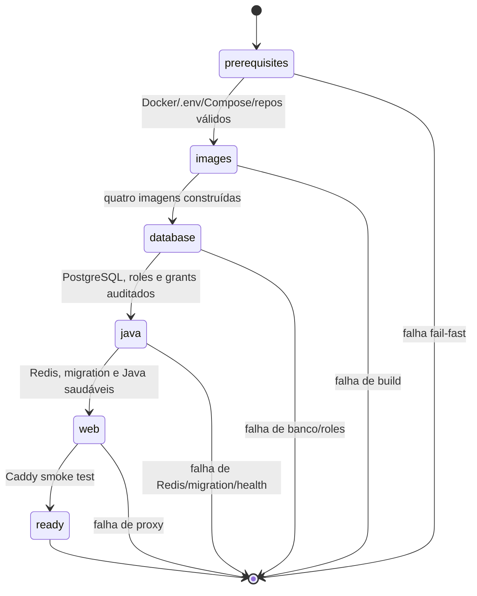

# `nss-deploy.sh`

O `nss-deploy.sh` é o orquestrador TTY do NSS. Ele prepara as imagens, sobe a
topologia Compose na ordem correta e valida cada dependência antes de avançar.
Não substitui o provisionamento do sistema operacional: Docker, Docker Compose,
rede, discos e segredos devem existir previamente.

## Máquina de estados



Cada estado concluído é gravado em `.nss-deploy-state`, que é local, temporário
e ignorado pelo Git. Um `up` ou `resume` repete somente os estados ainda não
marcados. O estado não substitui healthchecks: pré-requisitos e Compose são
validados em toda execução.

Cada estado também é executado com uma barra de progresso no TTY. A barra mostra
atividade e tempo decorrido, avançando até 100% quando o comando termina. Para
downloads e processamento, o script não inventa um percentual: a porcentagem é
deliberadamente indeterminada durante a operação, enquanto a saída detalhada é
impressa ao final. Assim, IBGE, CNES, Parquet e Gold têm feedback visual sem
confundir tempo de execução com quantidade de bytes ou linhas processadas.

## Arquivo de ambiente e secrets

`.env.example` do repositório `NSS-deployment` é o único modelo que deve ser
preenchido para o deploy integrado. Nunca copie valores reais para um
repositório. No servidor, copie esse modelo para `/etc/nss/deployment.env`,
preencha os valores e execute:

```bash
sudo install -o root -g root -m 600 .env.example /etc/nss/deployment.env
sudoedit /etc/nss/deployment.env
```

O caminho pode ser alterado com `NSS_ENV_FILE=/caminho/seguro`. O pré-voo
mostra esse caminho e valida Docker Compose, repositórios, variáveis obrigatórias,
placeholders e a configuração efetiva antes de construir qualquer imagem.

Para teste local integrado, use o arquivo completo de valores descartáveis:

```bash
cp .env.local.test .env
NSS_ENV_FILE="$PWD/.env" ./scripts/nss-deploy.sh up
```

Os outros repositórios também fornecem `.env.local.test` para execução isolada.
Altere apenas porta ocupada e caminhos dos repositórios quando necessário. Esses
valores nunca devem ser usados em homologação ou produção.

Não combine os `.env.example` de Java, Pipeline, frontend ou database no
servidor. O Deployment compõe a configuração efetiva e injeta cada variável no
serviço correto. Os arquivos de ambiente dos demais repositórios só são usados
quando aquele componente é executado isoladamente fora do Compose integrado.

O perfil local aponta para Mailpit e deixa SMTP sem autenticação. Antes de um
deploy real, substitua no arquivo externo do servidor `MAIL_HOST`, `MAIL_PORT`,
`MAIL_FROM`, `MAIL_USERNAME` e `MAIL_PASSWORD` por uma conta de envio dedicada;
`MAIL_PASSWORD` deve ser uma senha de aplicativo, com SMTP autenticado e
STARTTLS habilitado. Nunca coloque essa senha em `.env.example`, Git ou na linha
de comando.

No Gmail, basta ativar a autenticação de dois fatores na conta Google e gerar
uma senha de app nas configurações de segurança. Use o e-mail da conta como
`MAIL_USERNAME`/`MAIL_FROM` e a senha de app como `MAIL_PASSWORD`.

## Uso

```bash
# Subida inicial ou retomada após falha
./scripts/nss-deploy.sh up
./scripts/nss-deploy.sh resume

# Inspecionar estado e serviços sem alterar o estado persistido
./scripts/nss-deploy.sh status

# Limpar o checkpoint depois de recriar volumes ou trocar imagens
./scripts/nss-deploy.sh reset-state
```

O menu interativo continua disponível sem argumento. Antes do bootstrap, o
script apresenta o pré-voo numerado (Compose, repositórios, ambiente, Compose
efetivo e confirmação do operador). Ele não inicia containers enquanto uma
dessas verificações falhar.

## Operações da pipeline

Após a infraestrutura estar saudável, o menu inclui as operações de dados:

1. preflight da pipeline;
2. verificar release IBGE ativa;
3. baixar/promover nova release IBGE com URL e SHA-256;
4. verificar lotes CNES e seu status;
5. baixar CNES nacional com checkpoint;
6. verificar o manifesto de Parquets SINAN;
7. verificar e baixar atualizações SINAN por doença/ano;
8. executar Gold Serving, exigindo batch CNES `COMPLETED`.

Os comandos são executados dentro do serviço `pipeline` pelo Compose, usando o
volume `pipeline_data`. A atualização SINAN é incremental e preserva o
manifesto anterior quando uma fonte falha. O CNES usa checkpoint por lote e
`PARTIAL` nunca pode ser usado para enriquecer a Gold. A publicação nacional
exige confirmação explícita no menu.

As barras de progresso dessas operações correspondem às etapas abaixo:

```text
IBGE   [atividade + tempo] -> download -> validação -> promoção 100%
CNES   [atividade + tempo] -> requisições/checkpoint -> COMPLETED 100%
Parquet[atividade + tempo] -> manifesto -> download/skip -> 100%
Gold   [atividade + tempo] -> Bronze/Silver/Gold/load -> publicação 100%
```

## Pré-requisitos e mensagens de erro

O script verifica:

- `docker` e Docker Compose v2;
- dependências do host verificadas por `./scripts/check-host-dependencies.sh`;
- `.env` e todas as variáveis obrigatórias;
- `docker compose config`;
- os quatro repositórios de build.

No NixOS, essas dependências são declaradas pelo módulo `services.nss`. Antes
do bootstrap, execute:

```bash
./scripts/check-host-dependencies.sh
```

O teste verifica os comandos usados pelo script, incluindo Docker/Compose,
Git, curl, awk, `ss`, base64 e os utilitários POSIX. Python, Java, Node,
PostgreSQL e Redis pertencem às imagens/serviços Compose e são validados pelos
healthchecks e testes de integração correspondentes.

Os caminhos padrão são diretórios irmãos de `nss-deployment`:

```text
../NSS-database
../Site-Sala-de-Situa-o-de-Saude-Java
../NSS-front-end
../NSS-pipeline
```

É possível apontar caminhos diferentes sem editar o script:

```bash
export NSS_DATABASE_REPO=/srv/nss/NSS-database
export NSS_JAVA_REPO=/srv/nss/java
export NSS_FRONTEND_REPO=/srv/nss/frontend
export NSS_PIPELINE_REPO=/srv/nss/pipeline
```

## Manifesto de release

### Registry local opcional

O caminho padrão não exige registry: `NSS_PIPELINE_IMAGE_MODE=local-build`
constrói e executa as imagens no próprio host. Para produzir referências
imutáveis sem GHCR, habilite o registry loopback no NixOS e, após o build,
execute:

```bash
NSS_IMAGE_DIGEST_FILE=/var/lib/nss/releases/20261112.env \
  ./scripts/publish-local-images.sh
```

O comando publica as imagens locais no registry configurado, verifica os quatro
`RepoDigest` SHA-256 e gera um arquivo de variáveis sem credenciais. Esse
arquivo deve ser promovido junto com a release; não é um substituto para o
manifesto Git de commits.

`releases.yaml` fixa o repositório, a branch de origem e o commit exato dos
quatro componentes. O commit é a referência efetiva do build; a branch serve
para rastreabilidade e para o runner saber de onde buscar a versão.

O mesmo manifesto fixa a release territorial usada pelos jobs:

```yaml
ibge:
  catalogId: ibge-dtb-2025
  referenceYear: 2025
  dtbUrl: https://geoftp.ibge.gov.br/.../DTB_2025.zip
  expectedSha256: <sha256-verificado>
```

O NixOS apenas habilita e agenda o timer IBGE. O serviço lê esses quatro
campos do deployment em tempo de execução; uma nova release do IBGE é,
portanto, uma atualização revisada do manifesto, sem alterar a estrutura do
NixOS.

Valide o manifesto antes do bootstrap:

```bash
./scripts/nss-release.sh validate
```

No servidor, o runner deve sincronizar somente repositórios limpos e fazer
checkout dos commits fixados antes de construir:

```bash
./scripts/nss-release.sh sync
```

O comando `sync` recusa alterações locais ou staged para não sobrescrever
trabalho do operador. Os caminhos locais continuam sendo definidos por
`NSS_*_REPO`; eles não entram no manifesto versionado.

Quando algo não existe, a execução termina com o caminho exato, por exemplo:

```text
ERRO: repositórios ausentes: frontend em /srv/nss/frontend
```

O script não pergunta nem inventa valores para segredos. Variáveis ausentes
causam encerramento antes de iniciar containers.

## Banco e permissões

`start_database` sobe o PostgreSQL, aguarda `pg_isready`, executa o serviço
`db-permissions` e consulta as quatro roles esperadas. A migration central é
aplicada depois, pelo serviço `migrate`, antes do Java. O script não concede
permissões de arquivos no host ao Caddy/Nginx: permissões de proxy são as
definidas pela imagem e pelo Compose, e devem ser auditadas no ambiente alvo.

## Idempotência e recuperação

`docker compose up`, o provisionamento de roles e a migration foram desenhados
para serem repetíveis. O checkpoint evita rebuild e reinício de etapas já
concluídas. Se uma etapa falhar, corrija a causa e execute `resume`; para forçar
uma nova avaliação de tudo, use `reset-state` e depois `up`.

O script não implementa rollback automático. Rollback operacional deve usar
imagem anterior, backup aprovado e procedimento de restauração documentado em
`../docs/VALIDACAO_PLANO_LOCAL.md`.

## Limites

O modo `up` não executa ingestão CNES nem pipeline epidemiológica automaticamente.
Essas operações continuam explícitas no menu para evitar cargas nacionais
acidentais. Também não cria Docker no sistema operacional, certificados TLS,
DNS ou credenciais.
